# Local LLM Benchmark Suite

<a href="./assets/banner.png" target="_blank">
  
</a>

An automated, real-load benchmark for LLMs tested on [llama-swap](https://github.com/mostlygeek/llama-swap), this benchmark suite works out-of-the-box with any OpenAI API-compatible endpoint—including Ollama, llama.cpp, LM Studio, vLLM, and cloud providers.

## **Speed Test**
For every model on your server selected it measures generation speed (Technical + Logic prompts), prefill speed at the prompt lengths you actually deploy, agent-prompt time to first token, load time, prompt-cache efficiency and context size, while tracking GPU power, VRAM, temperature and CPU power. It reads what the server really loaded (launch flags and the GGUF header: KV-cache type, bits per weight, experts, KV cost per token). From those it derives energy per token, efficiency and (optionally) electricity cost. Note: Speed tests are quick and can be done seperately to evaluation tests.

## **Evaluation Tests**
After the speed tests it runs dataset evaluations that grade knowledge, math, coding, tool calling and long-context retrieval, then ranks the models for real use on that machine and builds a self-contained interactive dashboard. Different tests can be enabled and disabled. (Refer to Credits and datasets) A Full test would take hours and days across multiple models at once.
To manage this time efficiently, the suite uses three core mechanisms: **Evaluation Profiles**, **The Funnel**, and **Cached Results**.

1. **Evaluation Profiles & Margins of Error**
Fixed evaluation profiles determine how many rows (questions) are tested per benchmark, directly controlling the statistical margin of error:
* Smaller profiles (test, quick, basic): Run very quickly with fewer questions, resulting in a higher margin of error (e.g., $\pm20\%$ to $\pm40\%$). These are ideal for rapid sanity checks.
* Larger profiles (standard, thorough, deep, ultra, full): Test hundreds or thousands of questions per benchmark, shrinking the margin of error down to $\pm7\%$ or even $\pm1\%$. These provide high-precision comparisons but take significantly longer to execute.

2. **The Funnel Strategy**
To get the precision of deep evaluation without wasting hours testing underperforming models, The Funnel was developed.
* Graduated Stages: Instead of running every model through a massive question set, the funnel starts everyone on a small, fast set of questions (quick 11 per test).
* Confidence Gating: A statistical confidence gate then compares each model against the current leaders. Any model whose score falls clearly below the leaders (even accounting for its margin of error) is "screened out" and stops testing there.
* Survivor Advancement: The models that pass move on to the next, larger tier of questions (e.g., basic 24 $\rightarrow$ moderate 43 $\rightarrow$ standard 96) and are gated again, all the way up to your configured EVAL_FUNNEL_FINAL profile.
* Efficiency: Testing shows the funnel achieves the exact same ultimate winner as running every model through a full deep evaluation, but saves 40–50% of the total compute time. A guaranteed minimum number of top models (EVAL_LEADER = 5) always make it through regardless.

<a href="./assets/eval1.png" target="_blank">
  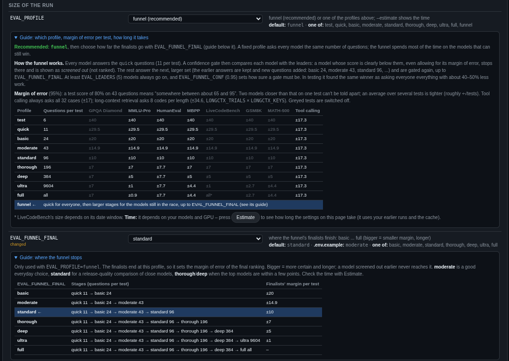
</a>

3. **Result Caching**
The evaluation suite includes a robust caching layer that stores past test results.
This allows you to:
* Reuse previous scores across runs without re-running completed tests.
* Progressively build up deeper evaluations over time.
* Spread out testing overhead across multiple runs rather than waiting for a massive batch all at once.
* To improve this cache process, we developed the Sanity Check %. A configurable percentage of cached answers is randomly re-tested to detect non-deterministic decoding or cache drift. Adaptive mode automatically reduces checks for models that remain consistent while keeping higher scrutiny on models whose outputs change.


* 📊 **Demo Dashboard:** [View Live Interactive Dashboard](https://htmlpreview.github.io/?https://github.com/Maximo101/Local-LLM-Benchmark/blob/main/assets/demo_dashboard.html)
* 📊 **RTX 5070 Dashboard:** [View Live Interactive Dashboard](https://htmlpreview.github.io/?https://github.com/Maximo101/Local-LLM-Benchmark/blob/main/assets/5070_benchmark_dashboard.html)
* 📊 **RTX 5070 Ti Dashboard:** [View Live Interactive Dashboard](https://htmlpreview.github.io/?https://github.com/Maximo101/Local-LLM-Benchmark/blob/main/assets/5070ti_benchmark_dashboard.html)

(if you would like to share results please contact us)

<a href="./assets/m1.png" target="_blank">
  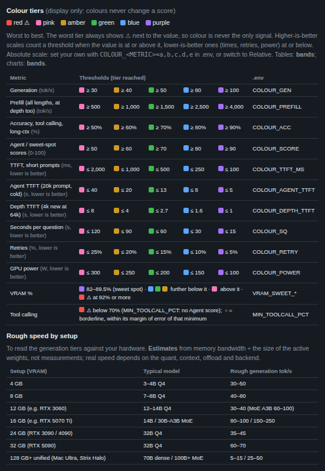
</a>

<a href="./assets/s1.png" target="_blank">
  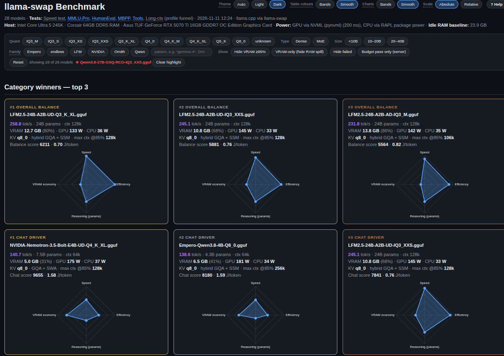
</a>

<a href="./assets/s2.png" target="_blank">
  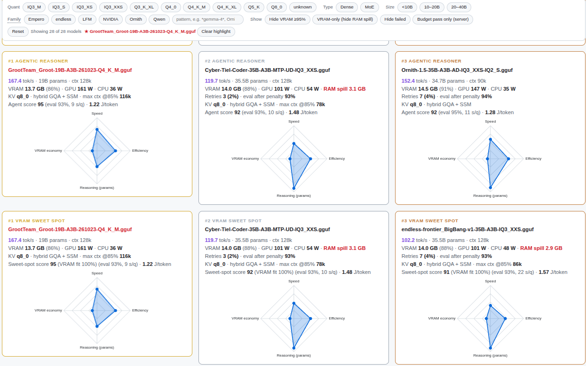
</a>

Settings Page
<a href="./assets/d1.png" target="_blank">
  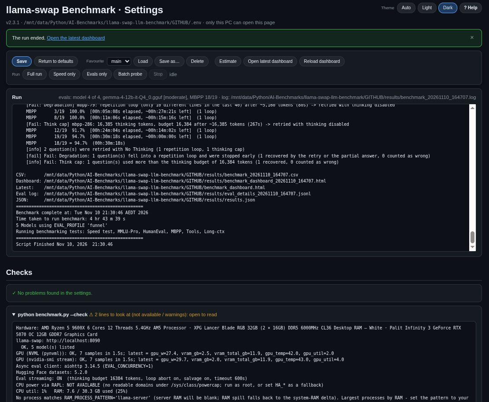
</a>

<a href="./assets/models.png" target="_blank">
  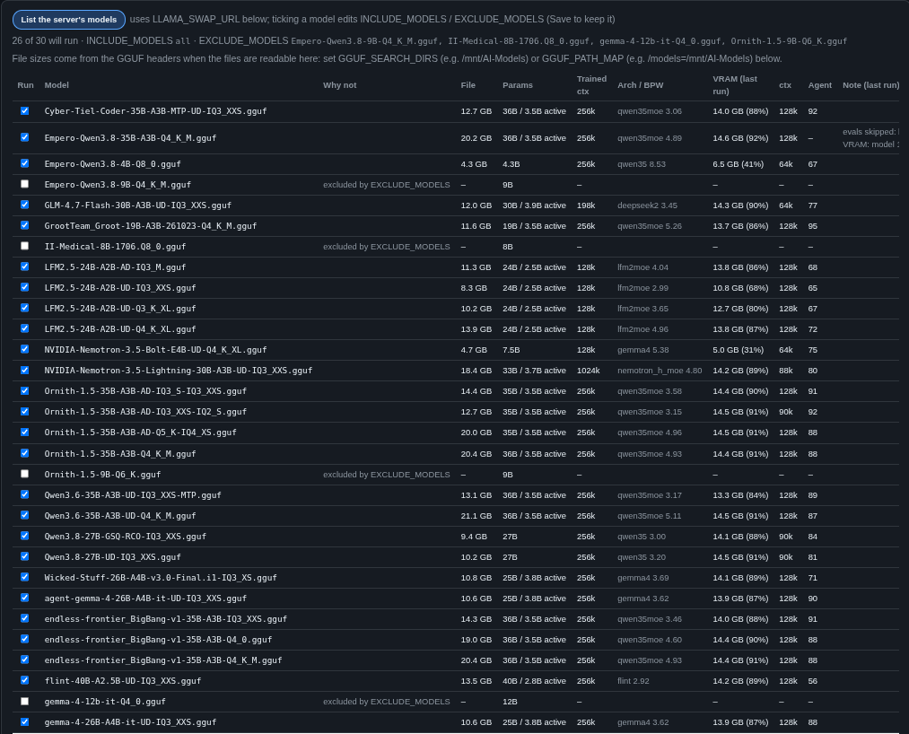
</a>

v1.0 Created a simple speed test and basic dashboard. v1.50 added basic evaluation tests. v2.1 added the tools to make that much shorter without making the ranking less trustworthy: a confidence-gated funnel, a per-question result cache with resume, batched evaluation with a measured probe, skipping models that cannot be deployed anyway, a single shared long-context document, and a per-phase timing report with `--estimate`. See [Making a full run faster](#making-a-full-run-faster). v2.2 addsed full-retest mode and sanity checks for the result cache, a cache-aware `--estimate`, and `--compare` to put runs (for example a Strata run and a llama-swap run) in one dashboard. v2.2.1 adds a settings file you can read at a glance, and a check for your `.env` v2.3 makes the Agent score fit agentic use (a minimum and a preference for long context, tool calling as its own part, a tool-calling minimum), adds **prefill at depth** (what an agent waits for each turn on a long, cached context), six colour tiers with a light theme and model families in the dashboard, and a **settings page** (`python benchmark.py --ui`) to edit `.env`, keep favourites, estimate, compare and start or stop runs from the browser. v2.3.1: runs that survive trouble, `--resume`, honest timings, a harder settings page. v2.3.2 adds Agent leaderboard, fixed chart order, top axis numbers, data-fitted scatter axes and other improvements to the full model comparison table. v2.3.3 adjusted how the funnel works and which results get shown in the dashboards.

## 🔌 Universal Compatibility (OpenAI API Standard)

While this benchmark suite was originally built and thoroughly tested using **llama-swap**, it is completely engine-agnostic.

Because the tool utilizes the industry-standard OpenAI API format (`/v1/chat/completions`), **any backend that mimics this format will seamlessly plug into the dashboard.**

This means it works out-of-the-box with:
* **Local Inference Engines:** `llama.cpp` (via `llama-server`), **Ollama** (which natively exposes an OpenAI-compatible endpoint), **LM Studio**, and **vLLM**.
* **Cloud Providers:** **Groq**, standard **OpenAI** endpoints, or any other API-compatible hosted service.

> ⚠️ **Note on Cloud Providers:** While the dashboard supports cloud-based OpenAI-compatible endpoints, **it is primarily optimized and tested for local hardware evaluation.** If you run comprehensive test suites against commercial cloud providers, standard API usage rates and token costs will apply.

### How to Connect
To use a different backend, simply update your environment variables or configuration file to point the **Base URL** and **API Key** to the correct local port or remote endpoint of your chosen inference server.

## 📦 Features

* **Real-load telemetry:** GPU power, utilization, temperature and VRAM read in-process through NVML (`pynvml`), plus CPU power from Intel/AMD RAPL, sampled during exactly the window of each request. If the NVML bindings are not installed, it falls back to a persistent `nvidia-smi -lms` stream.
* **Idle baseline per model:** Every model is unloaded first, the idle GPU is sampled, then the model is cold-loaded. This gives load time and attributes VRAM and power to the model under test.
* **Prefill and cache tests:** A long, unique prompt measures prompt-processing speed with the cache disabled. A cold-then-warm pair measures how much of a follow-up prompt is reused from the KV cache (a multi-turn chat proxy).
* **RAM and spill detection:** Peak system RAM (% used), the inference server's own RAM, the RAM change versus the idle baseline, and an estimated "RAM spill" for models that don't fit in VRAM. Works for Strata too.
* **Dataset evaluations:** Knowledge QA accuracy (GPQA Diamond, MMLU-Pro), math accuracy (GSM8K, MATH-500), code pass@1 (HumanEval, MBPP, LiveCodeBench, optionally limited to problems released after a date) and BFCL-style tool calling. Generated code is graded by executing it in an isolated Docker sandbox.
* **Long-context retrieval:** several needles and decoys hidden in one 32k / 64k / 128k document, at the KV-cache precision the model is deployed with.
* **What the server really loaded:** KV-cache type, flash attention, `-ub` / `-b`, slots and unified KV, CPU offload and mmproj come from the llama-server command line; architecture, bits per weight, experts, attention layout and KV bytes per token from the GGUF header. From these: KV GB at the loaded context and the largest context that would fit at a chosen share of VRAM.
* **Deployed-context speed:** prefill tok/s at 8k-128k prompt tokens, time to first token for an agent-shaped prompt (a tool catalogue plus a long history), and **prefill at depth**: ~4k new tokens on top of a cached long conversation (`PREFILL_DEPTH`, up to 64k), which is what an agent waits for on every turn. A model that is fast on short prompts can be slow where an agent actually works.
* **Per-machine budgets:** `BUDGET_PROFILE` rules (minimum context, VRAM reserve for other services, minimum KV precision, spill, speed, accuracy, retries) give every model a pass/fail per rule; failing models stay in the table but off the podium, and their evals can be skipped.
* **Streamed evaluations with loop abort, thinking cap and partial-answer salvage:** a reply that falls into a repetition loop (`Fail: Degradation`) or thinks past its budget (`Fail: Think cap`) is stopped within seconds instead of after a 10-minute timeout. A reply whose visible answer is already complete is graded as it is; otherwise the reasoning can be closed and the answer asked for (budget forcing, opt-in), or the question is retried once with thinking disabled. See [Streaming, loop abort and the thinking cap](#streaming-loop-abort-and-the-thinking-cap).
* **Honest margins:** every eval score carries its 95% margin of error; small profiles are flagged as a rough guide, ties within the noise are treated as ties, and a model whose evals are incomplete is not ranked.
* **Faster full runs:** funnel profile with confidence-interval gates, result cache and resume, batched evaluation capped to what the server's slots and KV pool can hold (with `--batch-probe` to measure the gain first), grading pipelined behind generation, one shared long-context document per length, and skipping the evals of models that cannot be deployed. A timing report shows where every minute went and `--estimate` predicts a run before it starts.
* **Hardened code sandbox:** Docker runs as a non-root user with no network, a read-only filesystem, dropped capabilities and memory/CPU/pid limits. A self-test runs at start-up and in `--check`, programs that exit early do not count as passes, and leftover containers are cleaned up automatically. Without Docker the run stops unless you explicitly accept an unisolated subprocess.
* **Context tracking:** Records the context size each model was loaded with, because VRAM and prefill speed depend on it.
* **Energy and cost:** Watt-hours, joules per token, tokens/sec per watt, and optional cost per 1M tokens / 1,000 queries at your peak and off-peak electricity rates. Optionally uses the GPU's hardware energy counter for exact per-request energy.
* **Click-to-highlight:** click a model name anywhere (table row, winner cards, quantization table, chart labels, bars or dots) and it turns red everywhere and becomes the table baseline. Click it again, or press Reset / Clear, to remove it.
* **Rankings for real use:** Goldilocks (parameters × average TPS), Chat (speed × free VRAM), Agent (quality first: evals, tool calling and long-context retrieval; a minimum and a preference for long context; speed second; no VRAM) and Sweet spot (Agent × how well the model fits the GPU). See [Metric definitions](#metric-definitions).
* **Strata fallback:** If llama-swap is down, the single model on a Strata server is benchmarked instead.
* **Interactive dashboard:** Filters, sortable and baseline-comparable table, charts (including Accuracy & Pass Rate graphs for knowledge, math and coding) and a radar per podium model. Hover any column header or dataset name for a short explanation; hide the columns you don't need. Six colour tiers per metric (flat bands or a smooth gradient, absolute or relative to the run), a light and a dark theme, model families as filter chips with a wildcard box, and a **? Help** page with every threshold and a speed-by-setup guide. See [The dashboard](#the-dashboard).
* **Settings page:** `python benchmark.py --ui` shows every `.env` setting with its description, default and choices, checks values as you type, saves `.env` (keeping `.env.bak`), keeps favourite setups in `configs/`, and runs the tool's own commands (estimate, reload, compare, run and stop). Localhost only unless you open it to your LAN with a token. See [Settings page](#settings-page---ui).
* **Rich outputs:** Per-run CSV, appended history CSV, structured JSON (`results.json`), optional Markdown report, per-question eval JSONL logs, a run log, and the HTML dashboard.

## 🛠️ Prerequisites

* **Python 3.9+**
* **An NVIDIA GPU, and the script must run on the machine that hosts it.** GPU telemetry comes from the local NVIDIA driver (NVML, or `nvidia-smi` as a fallback). Evaluation-only runs (`--evals-only`) work from any machine that can reach the API.
* **llama-swap** running and reachable over HTTP.
* **CPU power (optional):** RAPL energy counters (Intel, and AMD on Linux 5.8+). Reading them usually needs root. A Home Assistant power sensor can be used as a fallback.
* **Docker (needed for the code datasets):** Used to sandbox model-written code (HumanEval, MBPP, LiveCodeBench). Without Docker the run stops with an explanation; set `EVAL_CODE_SANDBOX=subprocess` to accept running generated code as your user in a restricted subprocess, which is not a security boundary.
* **llama-server slots (only if you use `EVAL_CONCURRENCY` > 1):** `-np N` with N at least `EVAL_CONCURRENCY`, and preferably `--kv-unified` so every request keeps the full context. See [Batched evaluation](#batched-evaluation-eval_concurrency).

## 🔬 Installation

1. Clone the repository:
   ```bash
   git clone https://github.com/Maximo101/Local-LLM-Benchmark.git
   cd Local-LLM-Benchmark
   ```

2. Install dependencies:
   ```bash
   pip install -r requirements.txt
   ```
   *(Note: `datasets` is required for evaluation testing and brings in `huggingface_hub` automatically. `nvidia-ml-py` (NVML) and `aiohttp` are optional at runtime: without them the tool falls back to `nvidia-smi` and a thread pool.)*

3. Configure your environment:
   ```bash
   cp .env.example .env
   ```
   Edit PART 1 (your setup) and PART 2 (your run) of `.env`; PART 3 is optional. After updating the tool, run `python benchmark.py --check-env` to find settings that are new, renamed or misspelt (see [Configuration](#configuration)).

### Project layout

`python benchmark.py` is a small launcher; the code lives in the `llmbench/` package next to it. The `.env` file, `results/` folder and `tests/` dataset cache are all resolved relative to `benchmark.py`, never the current directory.

```text
benchmark.py            launcher (all CLI flags)
llmbench/
  config.py             .env loading, Config, dataset specs
  client.py             llama-swap / Strata HTTP, backend detection, model selection
  speed.py              speed, prefill and cache tests for one model
  status.py             run_status.json (progress, heartbeat) and run_<stamp>.rows.json (--resume)
  pause.py              pause / resume (run_control.json, run_<stamp>.pause.json) and the MAX_GPU_TEMP guard
  modelinfo.py, gguf.py  launch flags, /props and the GGUF header (own reader)
  scoring.py            CSV schema, derived metrics, Goldilocks / Chat / Agent / Sweet-spot scores, budgets
  telemetry/            gpu.py (NVML + nvidia-smi), host.py (RAPL, RAM, launch flags), hardware.py
  evals/                datasets, answers, mathcheck, sandbox, grading, transport, streaming, runner,
                        funnel (CI gates), cache (result cache), longctx, toolcall
  reporting/            csv_out, markdown, json_out, dashboard (+ dashboard.html template), colours, margin
  agent.py              Agent score parts: context curve and minimum, composite, tool minimum
  estimate.py           --estimate
  batchprobe.py         --batch-probe
  diagnostics.py        --demo and --check
  envspec.py            --check-env (reads .env.example: parts, defaults, descriptions, choices)
  envfile.py            writes .env in the .env.example layout; favourites
  ui/                   --ui settings page (server.py, settings.html; standard library only)
  reload.py             --reload
  compare.py            --compare
  cli.py                run orchestration
configs/                settings-page favourites (<name>.env; git-ignored)
selftests/              pytest suite with a mock llama-swap server (no GPU needed)
```

## 🚀 Usage

**1. Verify telemetry sources**

```bash
python benchmark.py --check
```

Tests llama-swap, both GPU backends (NVML and `nvidia-smi`), the async client, RAPL, RAM, the inference process and, if a code dataset is enabled, the code sandbox self-test.

Check your settings file too (typos, values that won't work, settings new in this version):

```bash
python benchmark.py --check-env
```

Or open the settings page, which does the same checks as you type and can save `.env` for you (see [Settings page](#settings-page---ui)):

```bash
python benchmark.py --ui
```

**2. Run the full benchmark (Speed + Evals)**

```bash
python benchmark.py
```

**3. Run specific test suites**

```bash
# Run only the speed and hardware telemetry tests
python benchmark.py --speed-only

# Skip speed tests and run only the dataset evaluations
python benchmark.py --evals-only
```

**4. Choose which models run**

```bash
# Print what the server offers; [x] marks the models that will run
python benchmark.py --list-models
```

Narrow the list with `INCLUDE_MODELS`, `EXCLUDE_MODELS` and `MODEL_FILTER` in `.env`.

**5. Cache datasets locally**
Download the enabled datasets upfront to avoid network delays during the run:

```bash
python benchmark.py --download-datasets
```

**6. Inspect Strata's API (only if you use the Strata fallback)**

```bash
python benchmark.py --probe-strata
```

**7. Predict how long a run will take**

```bash
python benchmark.py --estimate
```

Uses earlier runs' JSON in `results/` (measured tok/s, prefill speed, seconds and tokens per question) and any batch-probe result; models without history get a rough guess from their size and quantisation and the GPU's memory bandwidth (`ESTIMATE_GPU_BW_GBS`, PART 1: `auto` looks up the detected NVIDIA GPU in a table of common cards, else 670 GB/s; a number overrides it, e.g. when estimating for another machine's GPU). Models that `EVAL_SKIP_INELIGIBLE` would skip (context below `MIN_CTX`, a failed budget rule) get no eval time. It also reads the result cache: it says whether the run will reuse cached answers or is a full re-run (`EVAL_RESULT_CACHE=refresh` / `false`), shows per model how many answers it expects to reuse, and counts only the rest (plus any sanity-check re-asks). A one-line estimate is also printed at the start of every run.

<a href="./assets/d3.png" target="_blank">
  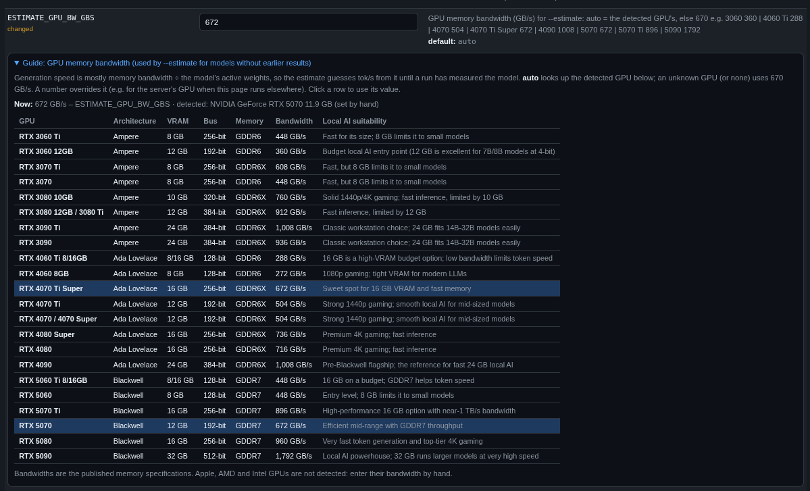
</a>

**8. Measure what batched evaluation gains on your GPU**

```bash
INCLUDE_MODELS=model-a,model-b,model-c python benchmark.py --batch-probe
```

See [Batched evaluation](#batched-evaluation-eval_concurrency).

**9. Resume an interrupted run, or fill in what failed**

Just run it again with the same `.env` and the same model list. Every answered question is kept in the result cache (`results/cache/`), so only what is missing or failed is asked; the speed tests are always measured again. For a full retest, set `EVAL_RESULT_CACHE=refresh` (asks everything and replaces the cached answers). To spot-check the cache instead, set `EVAL_SANITY_PCT` (see [Result cache and resume](#result-cache-and-resume)).

**10. Build a demo dashboard (no server needed)**

```bash
python benchmark.py --demo
```

The demo's files go to `results/demo/`. It never replaces `results.json`, the latest dashboard next to `benchmark.py`, or what `--reload`, `--estimate` and the settings page read.

**11. Rebuild the dashboard of the last run (no server needed)**

```bash
python benchmark.py --reload                                  # OUTPUT_DIR/results.json, the newest finished run
python benchmark.py --reload results/benchmark_20261109_004502.json
```

Mainly for working on the dashboard itself: it rebuilds the page from a finished run's JSON with the current dashboard code and writes `results/benchmark_dashboard_<run>_reload.html` (the run's own dashboard is kept) plus `benchmark_dashboard.html`. Nothing is measured or rescored: every number, score and ranking is the one the run stored, and the run's own settings are used rather than your current `.env`. Needs `JSON=true` (the default) during the run. A run stopped with **Ctrl+C** (or **Stop** on the settings page) still writes its JSON, CSV and dashboard with the models finished so far (status `interrupted`), so it can be reloaded too; only a run that was killed hard (`kill -9`, a closed terminal, a power cut) leaves no JSON. (The v2.1 release notes said an interrupted run can't be reloaded; that is only true for a hard kill.)

**12. Compare runs in one dashboard (e.g. a Strata model with your llama-swap models)**

```bash
python benchmark.py --compare                                     # newest llama-swap run + newest Strata run
python benchmark.py --compare results/benchmark_A.json results/benchmark_B.json
```

Combines finished runs into `results/benchmark_compare_<stamp>.html` (copied to `benchmark_compare.html`). Every model keeps its own measurements; the scores that compare models with each other (Agent score, sweet spot, budget eligibility) are computed again over all of them, with the first run's settings, so the ranking is the one a single run with all these models would give. Runs whose eval settings differ (seed, temperature, thinking budget, streaming switches) are refused, because they asked different questions or measured differently; `--force` combines them anyway and the dashboard says so. A model missing a dataset or questions is shown "not ranked: incomplete evals", as within one run. The dashboard gets a **Run** column and a **Run** filter to show or hide each run. Run both sides with the same eval settings in `.env`; a funnel run with a single model goes straight to the final profile, so a lone Strata model answers the same questions as a llama-swap run's finalists. A model that appears in both runs is shown twice, labelled with its run.

**13. Help - Lists all flags**

```bash
python benchmark.py --help
```

**14. Run the self-tests (optional, no GPU or server needed)**

```bash
pip install -r requirements-dev.txt     # the normal requirements plus pytest
python -m pytest selftests/
```

On a system Python that refuses pip installs (Debian/Ubuntu/Kubuntu), use `sudo apt install python3-pytest` or a virtual environment.

**15. Use another settings file, or check one**

```bash
python benchmark.py --env /mnt/user/bench/second-gpu.env      # a run with that file instead of .env
python benchmark.py --env /mnt/user/bench/second-gpu.env --estimate
python benchmark.py --validate                                # do the settings load? (prints OK or the error)
```

`--env FILE` works with every flag and needs a complete settings file (like `.env`). A favourite in `configs/` is not one: it holds only what differs from `.env.example` and no tokens, so load it on the settings page instead. The settings page uses `--env` for **Estimate** with unsaved settings.

## What happens for each model

**Speed phase** (every model, one request at a time, with telemetry):

1. All models are unloaded (`POST /api/models/unload`) and the GPU settles.
2. The idle GPU power and VRAM are sampled (baseline).
3. The model is cold-loaded (load time). Its context size, launch flags and GGUF header are read, and `MIN_CTX` is checked.
4. Technical, Logic and Prefill tests run, `RUNS_PER_PROMPT` times each. The median is reported. The prompt cache is disabled for these.
5. The cache test sends a long prompt cold, then again with a follow-up appended.
6. Prefill at each `PREFILL_CTX_TESTS` length (one cold, unique prompt each) and the agent-prompt TTFT (`AGENT_PROMPT_TOKENS`). A length that the long-context test also uses is taken from that test's first prompt instead of being sent twice. Then **prefill at depth** (`PREFILL_DEPTH`, default `auto` = per model the largest of 8k / 16k / 32k / 64k that fits the loaded context with the 4k turn: a model loaded at 64k is measured at 32k, every 90k+ model at 64k; a number fixes it): that prompt is kept in the server's prompt cache and ~4k new tokens (a tool result) are sent on top of it; only those new tokens count. It is not recorded when the server did not reuse the cached prefix.
7. After a short cooldown, the next model starts.

**Eval phase** (after all speed tests, telemetry stopped):

1. Models that already fail a deployment rule (`MIN_CTX`, the budget profile, `GOLDILOCKS_MAX_VRAM_PCT`) are skipped (`EVAL_SKIP_INELIGIBLE`).
2. For each model: a warm-up request loads it (timed separately, so the load is never part of a question's latency), `/props` is read (context, slots, chat template), the long-context test runs on one shared document per length, then the datasets.
3. Within a dataset, up to `EVAL_CONCURRENCY` questions are in flight, capped to what the server's slots and KV pool can hold. Replies are streamed; grading (including sandboxed code) runs while the next question is generating.
4. A stopped reply (repetition loop, thinking cap, timeout) whose visible answer is already complete is graded as it is; otherwise, and also when a reply is cut off by the token limit, the question is asked once more with thinking disabled (or, with `EVAL_BUDGET_FORCING=true`, the reasoning is closed and the answer asked for).
5. Every answer is stored in the result cache. With `EVAL_PROFILE=funnel` the models clearly below the leaders are dropped after each stage and the rest answer the next stage's new questions.

## Configuration

All settings live in `.env`, next to `benchmark.py`. `.env.example` is the complete, annotated list: copy it once (`cp .env.example .env`) and edit. It has three parts:

| Part | What is in it | What to do |
| --- | --- | --- |
| **1 · Your setup** | server address, RAM process name, budget profile, VRAM sweet spot, GPU bandwidth for estimates, the context your agents need (`AGENT_CTX_MIN`, `AGENT_CTX_PASS_PCT`, `AGENT_CTX_CURVE`), where Docker keeps the model files | check every line once per machine |
| **2 · Your run** | which models and datasets, profile / funnel, concurrency, prefill lengths, cache, sampling, thinking budget, output files | change between runs (`--estimate` first) |
| **3 · Optional** | telemetry, speed-test details, Agent score tuning, budget rules, sandbox, funnel tuning, dataset pinning, dashboard colours and families, the settings page, ... | nothing: every line is commented out and already at its built-in default |

How a line reads:

```ini
EVAL_PROFILE=funnel        # funnel (recommended) or one of the profiles above   [default: funnel]
# EVAL_LEADERS=5           # MINIMUM number of models kept at every gate (not a top-K cut)
# EVAL_LCB_SINCE=          # only problems released on/after, e.g. 2025-01-01
```

* An **active** line is used as written; `[default: ...]` is what you get if you delete it.
* A **commented** line shows the built-in default as its value; uncomment it to change it.
* A commented line with **nothing after `=`** is not set by default; the description says what happens then.
* For an empty value on an active line write `KEY=""`. With python-dotenv, `KEY=   # comment` reads the comment as the value.
* `true`/`false` also accept `1/0`, `yes/no`, `on/off`. Anything else, such as a typo like `tue`, is read as **false**.
* A value set in the shell environment wins over `.env`. If a key appears twice in `.env`, the last line wins.

### Checking your `.env` after an update

```bash
python benchmark.py --check-env            # or: --check-env path/to/other.env
```

This compares your `.env` with this version's `.env.example`. It reads files only: nothing is changed and nothing is sent to the server. It lists:

* **unknown settings**: a typo or a setting that was removed. They are ignored by the benchmark, and the check suggests the closest real name (`EVAL_TOOLCAL` -> `EVAL_TOOLCALL`).
* **values that won't work**: `tue` for a boolean, a word where a number is expected, `KEY=   # comment`, an unknown budget rule or dataset name.
* old setting names, keys set twice, and keys your shell also sets.
* **Part 1 / Part 2 settings missing from your `.env`** (typically new in this version), with the built-in default they fall back to.
* everything you changed from the built-in defaults.

It exits with status 1 if it found an unknown setting or an unusable value. A selftest checks that `.env.example` lists every setting the code reads and that each documented default matches the code, so the file and the code can't drift apart.

### Pausing a run, and the GPU temperature limit

A run can wait and carry on, by hand or when the GPU gets too hot. The same process waits: the model stays loaded, the run lock stays, and `run_status.json` (and the settings page) say `paused` and why.

```bash
python benchmark.py --pause      # ask the run that is going in OUTPUT_DIR to pause
python benchmark.py --resume     # while a run is paused: carry it on (otherwise: continue a run that stopped, see above)
```

The settings page has the same buttons (**Pause run**, **Resume run**, and **Resume last run** for a run that stopped). A request is a small file, `results/run_control.json`, so it also reaches a run on another machine that shares `OUTPUT_DIR`.

* **By hand:** nothing is cut off. The speed phase finishes the model it is testing; the evals stop taking questions, let the requests in flight finish and be graded, and then wait. Between two models or two datasets the run simply waits.
* **GPU too hot:** set `MAX_GPU_TEMP` (e.g. `85`, in C; `0` = off). The hottest GPU on *this* machine is watched on its own sampler, during speed tests and evals. At the limit the run stops at the end of the request that is going, waits until the GPU has been at or below `MAX_GPU_TEMP - GPU_TEMP_RESUME_DELTA` (default 10) for a few seconds, and carries on by itself. If the temperature cannot be read (no NVML or `nvidia-smi`) or llama-swap is on another machine, the limit is **not** enforced and the run says so.
* **Fresh start of the line that was going:** anything half done is thrown away and done again from its first step: a model's speed test (numbers taken on a hot or interrupted GPU are not kept), the dataset being evaluated, a model's long-context test. Finished models stay (rows file) and every graded answer stays (result cache), so the restarted dataset only asks the questions that were not answered yet. Scores are the same as an uninterrupted run's. With `EVAL_RESULT_CACHE=false` the restarted dataset asks everything again. In `eval_details_<stamp>.jsonl` an answer is never written twice; a repeated long-context record carries `"pause_restart": n`.
* **State on disk:** when the run pauses it saves its rows and writes `results/run_<stamp>.pause.json` (why, phase, model i of N, dataset and question count, finished models, a line per row, what will restart). The file is deleted when the run carries on. If the process is lost while paused, `--resume` carries on from the rows file and says where it had stopped.
* **A line that keeps tripping the limit** (more than `GPU_TEMP_MAX_RESTARTS`, default 3) ends the run like Ctrl+C (exit code 130, partial results written, resumable): improve the cooling or raise the limit.
* Time spent paused is in `phases.paused_s` of the JSON export (it is also inside `speed_s` / `eval_s`). The batch probe cannot be paused.

### Settings page (`--ui`)

```bash
python benchmark.py --ui            # prints the address; on a desktop it opens the browser: http://localhost:41010/
```

A page in the dashboard's style (light or dark) for everything in `.env`. Editing `.env` by hand and running from the command line or Unraid User Scripts work exactly as before; the page is optional.

* **Every setting** grouped by PART and section as in `.env.example`, with its description, built-in default, the `.env.example` value and, where there is a fixed set, a drop-down of the allowed values. Values are checked as you type with the same rules as `--check-env` and a run (a wrong value is marked in red with the reason). Settings new in this version, old names and unknown settings are listed under **Checks**. A filter box and *only changed* help find a setting.
* **Save** checks every value (and that a run would load them), then writes `.env` in the `.env.example` layout: your values on their own lines, untouched settings as shipped, anything `.env.example` doesn't know kept at the end. The previous file is kept as `.env.bak`. **Return to defaults** (asks first) writes the shipped `.env.example` values and keeps your tokens and keys.
* **Tokens and keys** (`LLAMA_SWAP_API_KEY`, `HF_TOKEN`, `STRATA_API_KEY`, `HA_TOKEN`, `UI_TOKEN`) are never sent to the page with the other settings; **show** fetches one when you ask, typing replaces it, **clear** removes it.
* **Favourites** in `configs/<name>.env`: only the settings that differ from the shipped `.env.example` (never tokens or keys), each with the shipped value at the time. The first visit saves your current `.env` as `main`. Loading a favourite starts from this version's defaults and puts it on top: renamed settings follow along, settings that no longer exist are listed, and where both the shipped value and your favourite changed a setting you choose which to keep. Nothing is written until you press Save.
* **Models:** lists the server's models (with the URL and key on the page) with a tick box each that edits `INCLUDE_MODELS` / `EXCLUDE_MODELS`, why a model would be skipped, its file size, parameters (total / active for MoE), trained context, architecture and bits per weight (from the GGUF header when the file is readable here via `GGUF_SEARCH_DIRS` / `GGUF_PATH_MAP`, else from the last run, else parameters from the name), and its VRAM, context and Agent score from the last run.
* **Guides** under `EVAL_PROFILE` (why `funnel` is recommended, how the funnel works, the margin of error per test for every profile, a link to Estimate for the time), `EVAL_FUNNEL_FINAL` (the stages and the finalists' margin for each choice), `ESTIMATE_GPU_BW_GBS` (common GPUs with their memory bandwidth; click one to use it) and the two temperature settings.
* **On opening** the page lists the server's models and runs `--check` (once per browser session; it tests the GPU readers and the code sandbox, so it takes a moment).
* **Buttons:** **Estimate** (with the settings on the page, saved or not), **Run --check again**, **Reload dashboard**, **Compare** (pick finished runs), **Open latest dashboard**, **? Help**.
* **Run / Stop:** **Full run**, **Speed only**, **Evals only** or **Batch probe** (`--batch-probe`) start the benchmark with the saved `.env`. One run at a time; it keeps going when you close the page, and the page follows its log again when you come back. **Stop run** asks first ("Existing run will stop, are you sure?"), then is Ctrl+C for the run: it finishes the current request and writes partial results (dashboard, CSV, JSON). A run started from the command line shows up too (`OUTPUT_DIR/.benchmark_run.json`), and a second run on the same GPU prints a warning.

* **While a run is active (v2.3.2)** the status next to the Run buttons is bold red (`running (pid ..., since ...)`; grey `idle` otherwise) and everything that changes state is locked: **Save**, **Return to defaults**, the favourites, **Reload dashboard**, the Run buttons, every setting and the model ticks. A click on any of them shows **Run active**. Estimate, the checks, Compare and opening the dashboard still work. The server refuses Save and Return to defaults during a run as well (HTTP 409), whichever page or script asks.
* **Context sizes:** every setting that takes a context size in tokens (`AGENT_CTX_MIN`, `AGENT_CTX_CURVE`, `LONGCTX_LENGTHS`, `PREFILL_CTX_TESTS`, `PREFILL_DEPTH`, `AGENT_PROMPT_TOKENS`, `MIN_CTX`, `STRATA_CTX`, `BUDGET_<PROFILE>_MIN_CTX`) has an ⓘ and a hover tip with the usual sizes: 4096 (4k), 8192 (8k), 16384 (16k), 32768 (32k), 65536 (64k), 98304 (96k), 131072 (128k), 262144 (256k), 524288 (512k), 1048576 (1M).

**Opening it from another PC** (a headless server, Unraid): set `UI_HOST=0.0.0.0` (or the server's LAN address) in `.env`. On the first start a token is generated, saved as `UI_TOKEN` and printed in the address (`http://192.168.1.20:41010/?token=...`). Open that address once; the browser keeps the token as a cookie. `UI_PORT` changes the port.

**Security:**

* Only `127.0.0.1` unless `UI_HOST` is set; on the LAN the token is required (a `UI_TOKEN` you set yourself is required on localhost too).
* Every button runs a fixed command of this tool (`--check`, `--check-env`, `--list-models`, `--estimate`, `--reload`, `--compare` with runs picked from the list, a run, Ctrl+C for the run). The page cannot run anything else and does not take file paths.
* The page refuses requests whose `Host` is not an IP address, `localhost` or this machine's name (DNS rebinding), and every change must come from the page itself (a custom header plus an `Origin` check), so another website open in your browser cannot drive it.
* Plain HTTP: on the LAN the token and any token you reveal travel unencrypted. That is fine on a home network; put a reverse proxy with HTTPS in front if you need more. Don't forward the port to the internet.
* Unsaved settings for **Estimate** go to a private temporary file (readable only by you) that is deleted straight after.

## Making a full run faster

On a 16 GB card with ~28 models, 94-98% of a full run is the GPU generating (or reading) tokens, and most of what it generates in the evals is thinking. Loads, cooldowns and sandbox start-up are a few percent. Single-request token speed is fixed by the hardware, so the levers are: ask fewer questions of models that are clearly losing, generate fewer tokens, and run several questions at once on the same card. None of them may let a weaker model rank higher, and each one below says how that is guaranteed.

| Lever | Setting | Typical saving | Why the ranking stays honest |
| --- | --- | --- | --- |
| Timing report + estimate | always on; `--estimate` | measures the rest | `results.json` (`run.timing`, `models[].timing`), CSV `time_*_s`, dashboard "Where the time went" |
| Skip undeployable models | `EVAL_SKIP_INELIGIBLE=auto` | the share of models that fail a rule | they are off the podium already; the Agent "bar" only ever came from eligible models |
| Funnel | `EVAL_PROFILE=funnel` | ~40-50% of eval work (more when the field is spread out) | a model is only dropped when its upper bound is below the leaders' lower bound; screened models are not ranked against the finalists |
| Batched evaluation | `EVAL_CONCURRENCY`, `--batch-probe` | eval time / 1.8-3 on dense models fully on the GPU (less for offloaded MoEs) | requests capped to the server's slots and KV pool; with concurrency the Agent score uses the single-stream s/q estimate |
| Result cache + resume | `EVAL_RESULT_CACHE=true` (`refresh` = full retest), `EVAL_SANITY_PCT` | reruns only ask what changed | an answer is reused only when the model file, launch flags, build, prompt, sampling and grader are identical; the sanity check re-asks a share of them |
| Pipelined grading | always on | the sandbox time (a few %) | grading is unchanged, it just runs while the next question generates |
| One long-context document per length | always on | about half of the long-context time, plus the separate 64k/128k prefill prompt | prefill tok/s depends on length, not content; questions ask different needles |
| Thinking budgets | `EVAL_THINK_BUDGET_<DATASET>`, `EVAL_BUDGET_FORCING` | 15-35% of tokens (model-dependent) | **opt-in only**: this changes what is measured (accuracy within a budget), recorded in the JSON and dashboard |

### Funnel (`EVAL_PROFILE=funnel`)

Every model answers the first stage (`quick`, 11 questions per dataset). **v2.3.3:** hard rules are applied first, then a gate compares the rest. After each stage the gate keeps every model whose upper bound (score + z × the error of its evals part + `EVAL_FUNNEL_MARGIN` points, one-sided at `EVAL_FUNNEL_CONF`, default 95%) reaches the lower bound (score − z × that error) of the `EVAL_LEADERS`-th best model, and never fewer than `EVAL_LEADERS` models. The error used is that of the **evals part only**: tool calling (32 cases) and long-context retrieval (8 per length) are asked in full at the first stage, so more stages cannot shrink their error, and counting it only kept every model alive (the v2.3.1 real runs pruned 1 of 26). The survivors answer the next stage (`basic`, `moderate`, ... up to `EVAL_FUNNEL_FINAL`, default `standard`); questions are nested, so each stage only asks the new ones. The compared figure is the one the Agent score ranks on: the composite of the evals, tool calling and long-context retrieval (v2.3; a model without a long-context result is compared on the parts it has). Tool calling is asked in full at every stage.

A plain "keep the top 5 after `quick`" was rejected: in a simulation with a crowded top (six models within six points) it screened out the true best model in 18-33% of runs. The confidence gates lost it in at most 0.1% of runs and picked as well as running everyone at the final profile. A screened-out model keeps its stage score (with its larger margin of error) and the column **First-stage avg** compares every model on the same first-stage questions, but it is **not ranked** and never on the podium.

Note: v2.1 samples questions as nested prefixes of one seeded order per dataset, so every profile's questions are a subset of the next one's. v2.0 drew each profile independently, so per-question results are not row-for-row comparable with v2.0 runs (the statistical precision is the same).

#### Three states: Ranked, Screened out, No Agent score (v2.3.3)

Every evaluated model ends in exactly one state (`rank_state` and `rank_reason` in `results.json`, a badge and a **Rank** filter in the dashboard, and a line per model at every gate in the log):

| State | Meaning | Decided by |
|---|---|---|
| **Ranked** | has an Agent score | passed every hard rule and was not screened out |
| **No Agent score** | fails a hard rule on its own measurements: loaded or usable context below `AGENT_CTX_MIN`, long-context below `AGENT_CTX_PASS_PCT` at every length that counts, tool calling below `MIN_TOOLCALL_PCT` | a rule, **outside the funnel**: no estimate, no margin of error, never compared with other models, never in the leaders' bar |
| **Screened out** | the funnel gate found it statistically clearly below the leaders after the first stages | the gate (reducible error + margin) |

A model that fails a hard rule is not asked further stages (`EVAL_HARD_FAIL=stop`, the default; `continue` keeps asking so its later-stage scores exist). If a result set contains both (for example one screened out by v2.3.2 that also fails the long-context rule), **No Agent score wins**. The log prints score ± the error the gate used (and the error of all parts), and the gap to the leaders' bar in decimals, for example `SCREENED OUT  82.00 +/-2.22 (all parts +/-2.56) gap -2.36`. A positive gap is how far inside the bar the model is.

The hard rules are only as strict as their settings: with the default `AGENT_CTX_MIN=65536` a model that passes 64k but fails 128k keeps its Agent score (with a lower context factor from `AGENT_CTX_CURVE`). Set `AGENT_CTX_MIN=131072` to make 128k mandatory; on the 2026-11-12 server run that would remove 13 of 26 models from the Agent ranking, because many are loaded at 64k-90k.

### Batched evaluation (`EVAL_CONCURRENCY`)

Generating tokens on one GPU is limited by memory bandwidth, so serving several requests in one batch raises the total tokens per second. llama-server needs slots for this (`-np N`). By default `-c` is the **total** context and each slot gets `c / N`; with `--kv-unified` (the default in current llama.cpp when `-np` is left at auto) all slots share one pool and each request may use the full context. Without it, `-np 4 -c 131072` gives every request 32k, which fails a 64k `MIN_CTX`.

The runner caps the requests in flight per model: never more than the server's slots, and with a shared pool never more than fit at their worst case (prompt + `max_tokens`, which the thinking budget limits to budget + 4,096). The cap is printed when it applies.

Measure before relying on it:

```bash
INCLUDE_MODELS=small-dense,mid-dense,offloaded-moe BATCH_PROBE_LEVELS=1,2,4,8 python benchmark.py --batch-probe
```

The probe asks the same `BATCH_PROBE_QUESTIONS` (default 32) questions at each level and reports aggregate tok/s, the **steady gain** over one request, per-question latency, accuracy, how many answers **agree** with the one-request answers (llama.cpp is not batch-invariant, so a few greedy answers can flip), request errors (a pool that overflowed) and peak VRAM. The steady gain is the throughput while the batch is full (Little's law: requests in flight × tokens per second of latency, relative to one request), so one long reply finishing alone at the end does not hide the gain. It recommends the smallest level that reaches 90% of the best steady gain with no errors and accuracy within the margin of error; agreement is only a rule (at least 90%) when 40 or more questions were asked, because with fewer a handful of chaotic flips is noise. Every probe answer is written to `batch_probe_<timestamp>_details.jsonl`. The probe reads context, slots and KV layout from the server, refuses more than 4 models (name them with `INCLUDE_MODELS`) and warns when other models are still being served (stop any other run first). `--estimate` uses the result, and models of the same offload class without a probe borrow the median gain of those with one.

**s/q under concurrency:** measured latency then includes waiting behind the other requests, and the in-flight cap differs per model. So when any model ran with more than one request in flight, the Agent score uses the **single-stream estimate** for every model: tokens generated ÷ the speed test's tok/s + prompt tokens ÷ its prefill tok/s + grading time (`EVAL_SQ_BASIS=auto`). With one request at a time the measured latency is used, exactly as before.

### Result cache and resume

Every answered question is stored in `results/cache/` (one JSONL file per model fingerprint). A cached answer is reused only when everything that could change it is identical: the model file (size and SHA-256 of its first and last MiB), the server's launch command (port, host, threads, logging and API key removed), llama.cpp's `build_info`, the loaded context and slots, the chat template, the hardware, the exact request (prompt, `max_tokens`, temperature, tools, `EVAL_EXTRA_BODY`), the thinking budget and retry/salvage/forcing switches, code-grading settings and the grader version. Change any of them and the question is asked again. If the model file is not readable from where the benchmark runs, the fingerprint falls back to what the server reports and says so. API errors are never cached. The speed tests and the long-context test are never cached.

* `EVAL_RESULT_CACHE=true` (default): reuse cached answers.
* `EVAL_RESULT_CACHE=refresh`: full retest. Every question is asked again, and the new answers replace the cached ones, so the next run can reuse them.
* `EVAL_RESULT_CACHE=false`: no cache at all; nothing is reused or stored.

**Sanity check (`EVAL_SANITY_PCT`, 0-100, default 0).** With the cache on, this share of the answers that would come from the cache is re-asked at random and compared with the cached answer (same pass/fail for code and tool calls; same extracted answer and verdict for multiple choice and math). The new answer is the one scored and stored. Differences are listed in the log (`[sanity] <question>: cached ..., now ...`), summed per model at the end, and shown in the dashboard's **Sanity diff** column. With `EVAL_SANITY_ADAPTIVE=true` (default) each model starts at `EVAL_SANITY_PCT`; every matching answer halves its rate, in whole percents, and below 2% the checks stop for that model for the rest of the run (from 20%: 20 → 10 → 5 → 2 → 0); a different answer puts it back to the full rate. Models that keep answering the same are checked less and less, and models that change keep being checked. Each run starts again at the full rate. Different answers under identical settings usually mean non-deterministic decoding (several requests batched on the server, or sampling at temperature > 0), not a broken cache. Picks differ per run (the seed is printed), so repeated runs check different questions.

**Keeping the cache valid between runs:** don't update the llama.cpp / llama-swap image (the build is part of the key), and keep the same `.env` eval settings and launch flags for the models you want reused. Changing a model's flags (for example `--n-cpu-moe`) or its sampling re-asks that model only. To complete a run where some models failed, rerun the **whole** model list: scores are relative to the best model in the run, and the cache makes the full rerun cheap. The cache holds model replies: do not publish it after a GPQA run.

### Resuming a run that stopped (`--resume`)

From v2.3.1 a run saves its rows to `results/run_<stamp>.rows.json` after every model, so a crash, a kill or a power cut loses at most the model being tested.

```bash
python benchmark.py --resume                    # the newest run in OUTPUT_DIR
python benchmark.py --resume 20261110_103848    # a named run
```

* Models whose speed test finished are kept. Models that failed, or were never reached, are benchmarked.
* The result cache answers every eval question already asked; only the missing ones are sent. With `EVAL_RESULT_CACHE=false` they are all asked again.
* A complete long-context result is kept; a missing one is run.
* A finished run keeps its rows file, so `--resume` also repairs it: only the models that failed to load, lost a test or have incomplete evals cost time.
* The resumed run has its own stamp. Resume on the machine and server the run was made on: the kept speed figures are that machine's.

If llama-swap stops answering during a run, the run waits up to `SERVER_WAIT_SECONDS` (default 600) for it, then asks the failed requests once more. While a run is going, `results/run_status.json` says where it is (the settings page shows it), and `NOTIFY_URL` gets a JSON summary when it ends. Exit codes: 0 complete, 2 stopped early with partial results, 130 stopped by Ctrl+C / Stop.

### Sampling: the benchmark's temperature or each model's own

Since v2.3 the default is `EVAL_TEMPERATURE=server` (and `TEMPERATURE=server` for the speed tests): no temperature is sent, so each model uses the sampling in its own llama-swap command (`--temp`, `--top-k`, `--top-p`, `--min-p`; llama-server's defaults where none is set), with `EVAL_SEED` as the sampling seed. This measures each model as you deploy it. Answers are no longer bit-identical between runs (sampling, plus batching), so small score differences mean less; the margin of error still applies. **Put each model's recommended sampling in its llama-swap command**; a model without any gets llama-server's defaults.

* `EVAL_TEMPERATURE=0` (a number): every eval request carries that temperature, which overrides `--temp` in your llama-swap commands. 0 = greedy: every model is measured the same, repeatable way, but some reasoning models (Gemma-family especially) loop under greedy decoding and lose points to the retry penalty. This was the default before v2.3: set it to keep using answers cached by earlier runs.
* `EVAL_SERVER_SAMPLING_MODELS=gemma|Wicked`: with a number above, only the matching models use their own sampling.

The dashboard's **Sampling** column shows what each model was evaluated with (`temp 0`, or `server: temp 1.0, top-k 64, top-p 0.95`). Switching a model between the two re-asks its questions (the request changes); models you don't switch keep their cached answers. Changing a model's sampling flags in llama-swap also re-asks it, because its launch command is part of the cache key. `--compare` refuses runs whose sampling settings differ.

### Recommended setup for choosing a model

```ini
EVAL_PROFILE=funnel
EVAL_FUNNEL_FINAL=standard
EVAL_LEADERS=5
EVAL_SKIP_INELIGIBLE=auto
BUDGET_PROFILE=server            # or main
EVAL_CONCURRENCY=1               # raise after --batch-probe, with -np / --kv-unified in llama-swap
```

Keep GPQA and LiveCodeBench for decisive runs: together they are about half of a full-profile run's time.

## 📊 Outputs

All results are saved to `OUTPUT_DIR` (default: `results/` next to the script).

* `benchmark_<timestamp>.csv`: Raw telemetry and benchmark data for the current run.
* `benchmark_history_v2.csv`: Every run appended over time. If new columns are added (for example when you enable GSM8K or MATH), older rows are migrated automatically and a `.bak` copy is kept.
* `results.json` and `benchmark_<timestamp>.json`: Structured export for dashboards, databases and notebooks. `results.json` is always the newest run and is written atomically, so it is safe to poll. See [JSON export](#json-export).
* `eval_details_<timestamp>.jsonl`: Per-question evaluation logs containing the model responses and grading logic. Each line has the verdict, `flag` (`Fail: Degradation` / `Fail: Think cap` / empty), `salvaged`, `forced`, `api_error`, `tokens` and `think_tokens`, `prompt_tokens`, `seconds` and `grade_s`, the funnel `stage`, `cached`, `sanity` (`same` / `different`, with the cached answer in `sanity_cached`, for re-asked questions), and `attempts`: one entry per request sent, with how it ended (`stop`, `length`, `loop`, `budget`, `timeout`, `error`), its mode (`think`, `forced`, `no-think`), its tokens and seconds, and for stopped attempts the reason and the last ~600 characters the model wrote. Long-context lines include the reused prefix (`cache_n`).
* `cache/`: the result cache (see [Result cache and resume](#result-cache-and-resume)).
* `batch_probe_<timestamp>.json`: written by `--batch-probe`.
* `benchmark_compare_<timestamp>.html`: written by `--compare` (also copied to `benchmark_compare.html`).
* `benchmark_dashboard_<timestamp>.html`: The interactive, self-contained dashboard for this run. The newest one is also copied next to the script as `benchmark_dashboard.html`.
* `benchmark_report.md`: Markdown report with the top 3, speed overview, full comparison, quantization analysis and eval results.
* `benchmark_<timestamp>.log`: Everything printed during the run, with start/end time and time taken.
* `.benchmark_run.json`: exists only while a run is going (its process id, start time and log), so the settings page can follow and stop it; removed when the run ends.

### JSON export

`results.json` has these top-level sections (`schema_version` 1):

| Section | Contents |
| --- | --- |
| `run` | Run id, start/end time, duration, status (`complete`, `interrupted`, `failed`), mode, backend, model counts, `timing` (wall time of the speed and eval phases, every model's phases summed, eval time per dataset, thinking and answer tokens) |
| `host` | Hardware, platform, Python version, GPU backend used, CPU power source |
| `config` | The settings used for the run (API keys and tokens are never written) |
| `evaluation` | Profile, seed, temperature, concurrency, HTTP backend, code sandbox, streaming settings (`stream`, `think_budget`, `think_budgets`, `budget_forcing`, `loop_abort`, `salvage`), `server_sampling_models`, `sq_basis`, `result_cache`, `result_cache_mode` (`true` / `refresh` / `false`), `sanity_pct`, `sanity_adaptive`, `skip_ineligible`, `funnel` (stages, leaders, confidence and every gate decision), margin of error, long-context settings, and per dataset the row counts, pinned `revision` and LiveCodeBench `since` |
| `artifacts` | Paths of every file written for the run, including the JSON itself |
| `models[]` | One entry per model: `metadata`, `speed`, `gpu`, `cpu`, `memory`, `energy`, `scores`, `launch`, `gguf`, `context`, `long_context`, `budget`, `timing` (seconds per phase), `evaluation` (`incomplete`, `skipped`, `screened`, `stage`, `stage1_avg_pct`, `in_flight`, `sec_basis`, `cached`, `sanity_checked`, `sanity_different`, `sampling`, tokens, and per dataset: `pct`, `n`, `rows`, `err`, `na`, `fallback`, `sec`, `sec1`, `trunc`, `degr`, `cap`, `salv`, `forced`, `tok`, `think`, `answer`, `ptok`, `grade_s`, `cached`, `wall`, `concurrency`), and `other` for any column not in a group |

v2.3 adds to `models[]`: `scores.agent_composite_pct`, `agent_longctx_pct`, `agent_ctx_factor`, `agent_borderline` (tool calling within its margin of the minimum) and `agent_basis` (the weights used), and `context.prefill_depth_tps`, `prefill_depth_ttft_s`, `prefill_depth_tokens` (the cached depth) and `prefill_depth_new` (new tokens sent). The CSV has the same columns; older history files are migrated.

Missing measurements are `null`, never `NaN`. A JSON file is also written when every model fails, so errors are machine-readable.

## The dashboard

* **Header:** Model count, the tests run, date, your host hardware (CPU, RAM, GPU) and the power sources used. Each dataset name links to the Hugging Face page it was loaded from (the pinned revision when `EVAL_<DATASET>_REVISION` is set; built-in tool calling links to its source file); hover it for a description.
* **Header:** next to **Tests**, a funnel run shows where its funnel stopped (**Funnel final: Moderate**; hover it for the stages and how many models reached the last one).
* **Filters:** A sticky toggle bar for quantization, Dense/MoE, parameter-size bucket, "Hide VRAM ≥95%" and "Hide failed". **▾ Filters** folds it to one line (the model count and the number of filters that are on stay visible); it starts folded on a phone and the choice is remembered in your browser.
* **Agent leaderboard (v2.3.2):** one full-width bar chart above everything else, best first. It ranks by the **Agent score**, which is already the combined figure (Agent quality × the speed factor); a dashed line on each bar marks that model's **Agent quality**, and **Rank by** switches the order to quality alone. The chart computes nothing new: both numbers are the run's own. Models without an Agent score are left out and counted in the note above the chart. Click a bar or a name to highlight that model everywhere.
* **Top 3 Goldilocks podium:** Gold/silver/bronze cards ranking Overall Balance, Chat Driver, and Agentic Reasoner (which factors in eval quality).
* **Charts:** two to a row on a wide screen, in this order: prefill vs generation speed | memory footprint; average generation speed | VRAM vs speed; active vs idle GPU power | prefill speed by prompt length; then power efficiency, energy per token, prompt processing time, latency vs throughput and speed by quantization, and **Accuracy & Pass rates** (knowledge, math and coding shown as separate groups).
  * The numbers of a numeric bottom axis are repeated above each chart, so a long chart can be read while its bottom axis is off screen.
  * The two scatter charts (**VRAM vs speed**, **Quality vs speed**) fit their axes to the data instead of starting at 0 (models that all score 80 to 100 are drawn on an axis from 75). A small gap looks larger there, so read the numbers; bar charts always start at 0.
  * Hiding a series in a chart's legend also hides its value labels.
* **Full model comparison:** Hover any column header for what it measures and which way is better. Hide columns with the × in a header or the **Columns** panel (single columns, whole groups such as Speed or Evals, or *Only this group*); **Show all columns** restores the full table. The choice is remembered in your browser, so the next run's dashboard opens with the same view. Columns with no data in a run are hidden automatically. **Resize a column** by dragging the right edge of its header (double-click the edge for automatic width, **Reset column widths** in the Columns panel for all of them; remembered in your browser); the header row is two rows high and its text wraps to the column, the data rows stay on one line and are cut with an ellipsis. The line above the table names the eval profile that ran, with the funnel's final stage and stages. Click a row to set it as a baseline, and every other row shows its +/- % against it. Models that are not ranked (incomplete evals, screened out by the funnel) or whose evals were skipped carry a badge; hover it for the reason.
* **Hide a model (v2.3.2):** the × in front of a model's name removes it from the table, the winners and every chart. **Hidden models** under the table lists what you removed, with **Restore** per model and **Restore all**. It is a view setting for the open page only (not remembered): scores were fixed when the run ended and do not change when a model is hidden.
* **Combined runs (`--compare`):** a **Run** column and a **Run** filter show which run each model comes from and hide or show a run's rows (the scores stay as computed over all models).
* **Where the time went:** time per model and phase (speed tests, eval load, long context, each dataset) as a stacked chart, the totals, and the thinking vs answer tokens generated.
* **Quantization analysis and methodology:** Per-quant averages, plus the exact definitions used for this run.
* **Colours (v2.3):** six tiers per metric, worst to best: red with ⚠, pink, amber, green, blue, purple. Generation tok/s 30 / 40 / 50 / 80 / 100, prefill 500 / 1,000 / 1,500 / 2,500 / 4,000 tok/s, accuracy and scores 50 / 60 / 70 / 80 / 90, and reversed scales for times (TTFT, s/q), retries and power; VRAM keeps its sweet-spot colours. The toggles at the top right switch **Bands** (flat tiers) / **Smooth** (a gradient between the tier colours) and **Absolute** (the thresholds) / **Relative** (tiers spread over this run's own range, so a slow GPU still shows which models are faster); they apply to the table and all charts. `COLOUR_STYLE`, `COLOUR_MODE` and `COLOUR_<METRIC>=t1,t2,t3,t4,t5` in `.env` set the defaults (e.g. a small GPU: `COLOUR_GEN=10,15,20,30,40`). Colours are display only and never part of a score.
* **Theme:** **Auto** follows your system, or pick **Light** / **Dark**. The light theme has its own tier colours with real contrast on white. The view choices are remembered in your browser; the theme is shared with the settings page.
* **Families:** chips in the filter bar group models by `DASH_FAMILIES` in `.env` (`Gemma=*gemma-4*;BigBang=*bigbang*`, several patterns per family with `|`) and automatically by the first word of the model name when two or more models share it (e.g. all `endless-frontier_BigBang` quants). Click chips to show only those families; the box next to them takes wildcard patterns, comma-separated, `*` and `?`, case-insensitive: `*gemma-4*` also finds `agent-gemma-4-26B...`. Chips and patterns combine with OR (either matches), and with the other filter groups (quant, size, ...) with AND.
* **? Help:** what the colours mean with every threshold for this run (and the VRAM and tool-calling marks), how the toggles and family patterns work, and a rough speed-by-setup table: the generation speed to expect from a few typical GPUs and model sizes (estimates from memory bandwidth, not measurements), to read the tiers against your hardware.


## Metric definitions

| Metric | How it is measured |
| --- | --- |
| Tech / Logic TPS | `timings.predicted_per_second` (median of `RUNS_PER_PROMPT`); falls back to completion tokens / wall time |
| TTFT | Approximated by `timings.prompt_ms` (prompt-processing time) |
| Prefill t/s, Prefill tok | `timings.prompt_per_second` on the long prompt, and that prompt's size in tokens |
| Load s | Time for the first request after unloading all models (cold load) |
| Ctx | Context size the model was loaded with, read from llama-server `/props` via llama-swap's `/upstream/<model>/props` |
| Cache hit % / Cache x | Share of the follow-up prompt reused from the KV cache (`cache_n`), and how much faster its prompt processing was than the cold prompt |
| RAM vs idle GB | Increase in system RAM over a baseline sampled with all models unloaded (llama-swap only) |
| System RAM | Absolute system RAM in use (`MemTotal - MemAvailable`), peak during the tests. Other dashboards may use another formula or sample at another moment |
| Server RAM GB | Peak resident memory (RSS) of the inference-server process. Always includes overhead (CUDA context, pinned buffers, mapped pages) |
| CPU offload | Read from the server's launch command: `-ngl` below 99, `--n-cpu-moe`, `--cpu-moe`, `--no-kv-offload`, `-ot ...CPU`. `none` means launched fully on the GPU |
| RAM spill GB | 0 for models launched fully on the GPU. For models with CPU offload: Server RAM minus the typical overhead. If launch flags can't be read (Strata), Server RAM when it is at least `RAM_SPILL_THRESHOLD_GB`. An estimate |
| GPU W / Idle W / Peak W | Mean power during generation, power with no model loaded, and the maximum |
| CPU W | RAPL package power (or the Home Assistant sensor) during generation |
| Energy Wh | (mean GPU W + mean CPU W) x request time, for one Technical plus one Logic request. With `GPU_ENERGY_COUNTER=true` the GPU part is the hardware energy counter delta instead of mean power x time |
| J/token | Energy divided by generated tokens |
| TPS/W | Average TPS divided by (GPU W + CPU W) |
| Cost | Measured GPU + CPU energy x your electricity rate. Excludes the rest of the system. "Per 1k queries" uses the average of the Technical and Logic requests, so it scales with `MAX_TOKENS_*` |
| Goldilocks | params (B) x average TPS, using total parameters from the GGUF header (else the filename) |
| KV type, FA, -ub / -b, Slots, Unified KV, CPU offload, mmproj | Read from the llama-server command line (`/proc/<pid>/cmdline`, else llama-swap's `/running`). KV type defaults to f16 when no `-ctk/-ctv` flag is given. Unified KV is blank when `-np` is left at auto (current llama.cpp then enables it) |
| BPW, GGUF GB, Experts, Attention, Full-attn layers, Train ctx | From the GGUF file header (own reader; the file is found through `/proc/<pid>/root`, `GGUF_PATH_MAP` or `GGUF_SEARCH_DIRS`) |
| KV KiB/tok, KV GB @ctx | KV-cache bytes per token from the header's layer/head layout and the KV type (sliding-window layers counted at their window), times the loaded context |
| Max ctx @X% | The context that would fit with VRAM at `MAX_CTX_VRAM_PCT` of the GPU: loaded context + (X% of VRAM - measured VRAM) / KV bytes per token, capped at the training context |
| Prefill 8k...128k t/s | `timings.prompt_per_second` for one cold, unique prompt of that length (`PREFILL_CTX_TESTS`). A length the long-context test also uses is taken from its first, cold prompt |
| Agent TTFT s / Next-turn TTFT s | Time to first token for an agent-shaped prompt of `AGENT_PROMPT_TOKENS` (a 16-tool catalogue plus a long history), cold, and for the next turn of the same conversation (prefix cached) |
| Prefill @depth t/s, @depth TTFT s | ~4,096 new tokens (a tool result) sent on top of a cached prompt (`PREFILL_DEPTH`; auto = up to 64k, column **Depth**): `timings.prompt_per_second` and `prompt_ms` of the new tokens only, the turn-by-turn cost an agent pays on a long context. Needs llama-server prompt-cache reuse on the same slot (`cache_prompt`, the default); recorded only when at least 90% of the cached prefix was reused. Blank when not even 8k + 4k fits the loaded context. The Agent score compares it only between models measured at the same depth |
| Long-ctx % | Share of asked vault codes returned, over `LONGCTX_TRIALS` questions about one document of that length, each asking `LONGCTX_KEYS` different vaults among as many decoys; asked with thinking off. A model that thinks anyway and spends its whole reply on reasoning is asked once more with 4,096 tokens (noted, and `thinking_retry` in the details). Flagged when the KV type is below `LONGCTX_KV_MIN` |
| Tool calling % | Built-in BFCL-style cases (simple, multiple, parallel, irrelevance) sent as OpenAI `tools` requests, graded on function name and arguments |
| Budget columns | One pass / fail / ? per `BUDGET_PROFILE` rule. VRAM rule: model VRAM + `VRAM_RESERVE_GB` <= GPU total x `MAX_VRAM_PCT`. `?` = not measured, never a fail. A failing model stays off the podium (`BUDGET_PODIUM_PASS_ONLY`) |
| Margin of error | 95% binomial interval, worst case: ±98/√n points per dataset (`test` ±40, `quick` ±30, `basic` ±20, `moderate` ±15, `standard` ±10, `thorough` ±7). `test` and `quick` are flagged as a rough guide |
| QA accuracy (GPQA, MMLU-Pro) | The model ends with `Answer: X`; the last such letter (or `\boxed{}`, or a final line that is just a letter) is compared with the dataset answer |
| **Math accuracy (GSM8K, MATH-500)** | The model ends with `Answer: <answer>`. The last `Answer:` line is used, else the last `\boxed{}`, else (GSM8K only, and never for a cut-off reply) the last number. Answers are normalised (units, `\dfrac`, thousands separators, `x=` prefixes) and match when the strings are equal or both are numerically equal (fractions, decimals) to 1e-6. Answers that are only equivalent after algebra count as wrong, so scores are a slight lower bound |
| Code pass@1 (HumanEval, MBPP, LiveCodeBench) | The last Python block of the reply is executed in the sandbox. HumanEval uses the task's `check()`, MBPP its `test_list` asserts, LiveCodeBench public tests plus up to `EVAL_LCB_MAX_TESTS` more (stdin/stdout or starter-code function). A program that exits before its tests finish fails |
| N/A | A reply that was cut off by the token limit and has no usable answer, even after the No Thinking retry. Counted as wrong, tracked separately |
| **Fail: Degradation** | The model's reply fell into a repetition loop (the same block of text over and over, or the same few sentences recycled) and was stopped. Counted per question in `degr` (CSV `eval_<dataset>_degr`), even when the retry then answered correctly; a question that still has no answer afterwards is wrong. Detection is conservative (exact repetition only), so a numbered enumeration is never mistaken for a loop |
| **Fail: Think cap** | The reply used more than `EVAL_THINK_BUDGET` (or `EVAL_THINK_BUDGET_<DATASET>`) tokens of thinking and was stopped. Counted in `cap` (JSON). Thinking is recognised when the server splits it out (`reasoning_content`) or when it sits between `<think>` tags |
| **Salvaged** | A stopped reply whose visible answer already contained a final answer (QA, math) or a complete code block, so it was graded as it is. Counted in `salv`. Thinking text is never used for salvage |
| **Forced** | A question answered by budget forcing (`EVAL_BUDGET_FORCING=true`): at the thinking cap the reasoning was closed and the model asked for its answer. Counted in `forced` |
| **tok, think, answer** | Mean tokens generated per question over all attempts (exact when the server reports usage, otherwise estimated), and the dataset's total thinking and answer tokens. In the JSON (and CSV totals `eval_tok_think` / `eval_tok_answer`) |
| **s/q** | Mean latency of one question: request, retries, timeouts and grading (never the model load: a warm-up request comes first). It is deliberately not dataset wall time divided by questions. With requests in flight it includes queueing, so `sec1` (JSON) is also given: the single-stream estimate, tokens ÷ speed-test tok/s + prompt tokens ÷ prefill tok/s + grading. Real elapsed time is `eval_<dataset>_wall` |
| **Eval avg %** | Mean of the dataset scores. Only for a model with a score on **every** dataset of the run (at least 90% of each dataset's questions answered without an API error); otherwise the model is **not ranked** and the reason is shown ("incomplete evals: GPQA 0/96 answered") |
| **Retries, Eval − retry penalty** | Share of questions that needed the No-Thinking retry, and the eval average minus `AGENT_FALLBACK_PENALTY` × that share |
| **Agent Score** | 0-100, quality first (v2.3). **1. Composite quality** = the eval average (every dataset except tool calling) 45%, tool calling 30% (`AGENT_TOOL_WEIGHT`), long-context retrieval 25% (`AGENT_LONGCTX_WEIGHT`); a part the run doesn't have gives its weight to the evals. Long-ctx counts only the lengths **every** ranked model ran (a 90k model that skipped 128k is compared on the same questions); a model with no long-ctx result at 64k is not ranked, so long-ctx stays in everyone else's composite (only with `AGENT_CTX_PASS_PCT=0` is it left out for everyone, with a note). The composite is compared with the best of the run: within one standard error of the best composite (from each part's question count) = a tie at 100, below that a quadratic fall to 0 at `AGENT_ACC_SPAN` (40) points under the tie zone. **2. After the tie zone** (so they separate tied models): × (1 − `AGENT_FALLBACK_PENALTY`% × the share of questions retried) and × the **context factor** from `AGENT_CTX_CURVE` at the **usable context** (128k+ 1.0, 77k 0.97, 64k 0.95, linear between: a mild preference; an unknown context is not penalised). The usable context is the loaded context, capped at the longest long-context length that reached `AGENT_CTX_PASS_PCT` (75%) when a length that fits did not: a 128k model that finds 12% at 128k counts as 64k, a 90k model that passed 64k counts as 90k, and a length without a result does not count as passed. **3. Speed factor** (0-1): prompt processing 50% (prefill at depth 60%, credit halving at about 1,333 tok/s; cold agent-prompt TTFT 40%, `1/(1 + TTFT ÷ AGENT_TTFT_REF)`; whichever exist, else `ln(longest prefill tok/s) / ln(AGENT_PREFILL_REF)`), s/q 30% (`1/(1 + s/q ÷ AGENT_SEC_REF)`), generation 20% (`ln(TPS) / ln(AGENT_TPS_REF)`); missing parts are left out. `score = quality × (1 − W + W × speed)` with `W = AGENT_SPEED_WEIGHT` (0.3), so speed separates models of equal quality but never lifts a clearly weaker one. VRAM is not part of it. **No Agent score** when the evals failed, are incomplete, were skipped or screened out, the usable context is below `AGENT_CTX_MIN` (64k: a model must pass the 64k long-context test), or tool calling is below `MIN_TOOLCALL_PCT` (70%; ≈ marks a model within its margin of error of that minimum). Tool calling runs in full (all 32 cases) at every profile and funnel stage. **Without evals in the run:** a proxy from dense-equivalent size (a MoE counts as √(total × active)) with a penalty below ~4.5 bits per weight, relative to the largest, also 0-100, marked as a proxy, with the same context rules |
| **Composite, Long-ctx (Agent), Usable ctx, Ctx factor** | The Agent score's parts per model: the composite quality before the tie zone, the long-context average it used (over the common lengths), the usable context and its factor |
| **Funnel stage, First-stage avg** | The last funnel stage a model answered, and every model's average on the first stage's questions only (like-for-like across finalists and screened models) |
| **In flight** | Requests a model actually had in flight during the evals (after the slot / KV-pool cap). Shown when `EVAL_CONCURRENCY` > 1 |
| **Time min** | Everything this model took in the run (speed tests, loads, long context, evals). Per phase in the JSON |
| **VRAM fit %** | 100% when VRAM use is inside `VRAM_SWEET_LOW`-`VRAM_SWEET_HIGH` (default 80-90%); falls gently below it, to 50% at `VRAM_SWEET_MAX` (94%) and 0 at 100% |
| **Sweet spot** | `Agent score × VRAM fit`: the most capable model that also uses the GPU sensibly (some headroom, nothing wasted). Ranked in the podium's "VRAM sweet spot" row |
| **VRAM tuning hint** | Under the band with CPU offload: room to lower `--n-cpu-moe`. Over the band: raise `--n-cpu-moe` or cut ctx / KV cache. Tip: add several llama-swap entries of one model with different `--n-cpu-moe` values and the Sweet spot ranks them |


<a href="./assets/s7.png" target="_blank">
  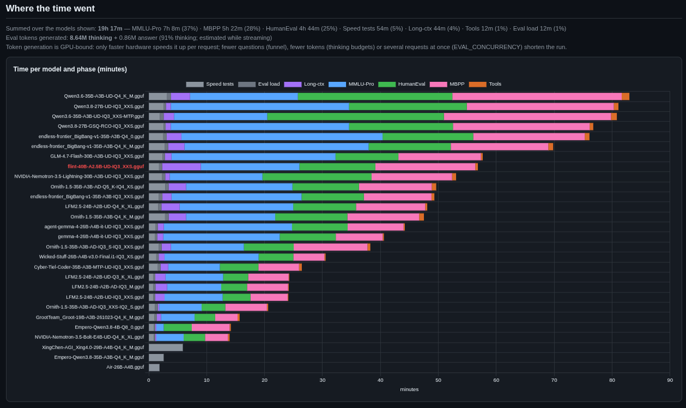
</a>

## Streaming, loop abort and the thinking cap

Reasoning models can fall into endless loops, and a non-streaming request returns nothing until the model has finished, so a looping reply used to run into the 10-minute timeout and the benchmark learned nothing about it. Since v2.1 the evaluation phase reads replies as a stream (the speed tests do not), which allows:

1. **Loop abort:** a reply that repeats itself is stopped within seconds and flagged `Fail: Degradation`. A line is printed as it happens, for example `[Fail: Degradation] gpqa-10: repetition loop (a 59-character block repeated 67+ times) after ~1,058 tokens (7s) -> retried with thinking disabled`.
2. **Thinking cap:** `EVAL_THINK_BUDGET` limits the thinking per question. The default, `auto`, gives each model `EVAL_THINK_BUDGET_PCT` (25) % of its own context (131,072 gives 32,768; 65,536 gives 16,384), never below `EVAL_THINK_BUDGET_MIN` (4,096 tokens) and never above `EVAL_THINK_BUDGET_MAX_PCT` (60) % of the context, so a small context still leaves room for the answer. A number fixes it for every model and `0` is unlimited. `EVAL_THINK_BUDGET_<DATASET>` (e.g. `EVAL_THINK_BUDGET_GSM8K=2048`) overrides it for one dataset. The server is also told `max_tokens <= budget + 4096`. The run prints each model's budget (`thinking budget 32,768 tokens (25% of 131,072 ctx)`), and the settings page shows the budget for each context size when you hover the ⓘ on these settings.
3. **Partial-answer salvage:** a stopped reply whose *visible* answer is already complete is graded as it is. Otherwise the question is retried once with thinking disabled (`EVAL_RETRY_ON_LENGTH`), and if that fails too it counts as wrong and keeps its flag.
4. **Budget forcing (opt-in, `EVAL_BUDGET_FORCING=true`):** at the thinking cap the reasoning written so far is kept, the thinking block is closed, and the model is asked for its answer (through llama-server's `/apply-template` and `/completion`, for chat templates that use `<think>` tags). This keeps the work already done instead of throwing it away for a No-Thinking retry. Method from *s1: Simple test-time scaling* (Muennighoff et al., 2025). It changes what is measured compared with the retry, so compare runs with the same setting. llama-server's own `--reasoning-budget` launch flag is an alternative on the server side.
5. **Evidence:** the tail of every stopped reply is kept in `eval_details_*.jsonl` (`attempts[].tail`), and the per-dataset summary shows how many questions were affected and how many were recovered.
6. **No runaway generation:** closing the connection makes llama-server stop generating. (A non-streaming request that times out is not reliably cancelled, so the abandoned generation could keep the GPU busy and slow the next question down.)

Any budget is a judgement call: it keeps a run's duration predictable, but a model that needs more thinking than its budget for a question is scored as if it had not answered that way. Every cap hit is counted, so you can see how many questions were affected and raise the budget if it matters to you (`EVAL_THINK_BUDGET_PCT`, or a fixed number, or `0` for unlimited). Per-dataset budgets are opt-in for the same reason: a tight budget measures "accuracy within N thinking tokens", which can reorder models (a strong model that reasons at length can drop below a terse weaker one). The budgets in use are recorded in `results.json` and shown in the dashboard's methodology. Set `EVAL_STREAM=false` to switch streaming off. Because the budget is part of the result-cache key, changing it (or moving from v2.3.2's fixed 16,384 to `auto`) re-asks the questions whose budget changed; `EVAL_THINK_BUDGET=16384` keeps old cached answers and results comparable. A bigger budget also means fewer requests fit in the shared KV cache at once, so `in flight` can drop (for example from 4 to 3 at a 128k context).

## Troubleshooting

* **GPU telemetry unavailable / VRAM about 0:** The script must run on the GPU host with the NVIDIA driver loaded. Install `nvidia-ml-py` for NVML, or have `nvidia-smi` on the PATH for the fallback. Inside a container it needs the NVIDIA runtime. Run `python benchmark.py --check`, which tries both backends and shows samples from each.
* **CPU power missing:** RAPL counters are often root-only, and are not visible inside most containers. Run as root, point `RAPL_PATH` at the counters, or configure the Home Assistant fallback.
* **Load time and VRAM delta are blank:** The unload call (`/api/models/unload`) failed. Check your llama-swap version.
* **Ctx column is blank:** The context size could not be read from `/upstream/<model>/props` or `/running`. The benchmark itself is unaffected.
* **Server RAM / RAM spill is blank:** No process matched `RAM_PROCESS_PATTERN`. Run `python benchmark.py --check`, which lists the largest processes by RAM, and set the pattern to your server's executable name. The script must run on the host (as root) to see processes inside Docker.
* **A model shows RAM spill but should be fully in VRAM:** Check its `CPU offload` column. Spill is only reported when the launch flags offload to the CPU. If a model has no offload flags but high Server RAM, it is probably runtime overhead or leftover mapped file pages, and it is not counted as spill. If you rely on llama.cpp's automatic fitting instead of explicit flags, the script cannot see that; set explicit `-ngl` / `--n-cpu-moe` values.
* **Parameter count or quantization shows wrong or unknown:** Both are parsed from the model filename. Models without a `NNB` tag can't be ranked by Goldilocks.
* **Results in the wrong folder:** Remove `OUTPUT_DIR` from `.env`, or set an absolute path. Relative values are resolved against the script's folder.
* **Results are not comparable between models:** Context size and KV-cache type can differ per model in your llama-swap config and affect speed and VRAM. Compare models with a similar Ctx.
* **Docker/Sandbox issues during evals:** The sandbox self-test runs when the datasets load and in `--check`. If Docker is unavailable or fails it, the run stops with the reason (v2.0 fell back to a subprocess with only a warning, which in an unattended run meant executing untrusted code as your user). Make sure the Docker daemon is running and your user can use it, or set `EVAL_CODE_SANDBOX=subprocess` (only for models you trust). Containers left behind by an interrupted run are removed automatically on the next start.
* **Evals are no faster with `EVAL_CONCURRENCY` above 1:** The run prints `in flight: 1 (capped: ...)` with the reason. Give llama-server slots (`-np N`, N at least `EVAL_CONCURRENCY`) and `--kv-unified`, and check llama-swap's `concurrencyLimit` for that model (when it is reached llama-swap answers 429 instead of queueing). With a shared KV pool, raise `-c` or lower `EVAL_THINK_BUDGET` if the cap is the pool. Run `--batch-probe` to see the real gain.
* **A model shows "not ranked":** hover the badge. *Incomplete evals*: a dataset failed or stopped early (often a chat-template / `--jinja` problem); fix it and rerun (the result cache keeps everything else). *Screened out*: the funnel found it clearly below the leaders; its first-stage score is still shown. *Evals skipped*: it fails a deployment rule (set `EVAL_SKIP_INELIGIBLE=false` to evaluate it anyway).
* **A rerun finishes instantly / did not ask anything:** the result cache had every answer. Set `EVAL_RESULT_CACHE=refresh` to measure everything again (the new answers replace the cached ones), or `EVAL_SANITY_PCT` to spot-check a share of them.
* **A rerun asked everything again although nothing changed:** something in the cache key did change, most often the llama.cpp build (an updated llama-swap container image), a launch flag, the context size or an eval setting in `.env`. `--estimate` shows how many answers it expects to reuse per model.
* **Many `Fail: Degradation` lines, or questions taking 10 minutes:** Reasoning models often loop under greedy decoding (`EVAL_TEMPERATURE=0`; Gemma-family models especially). With the default `EVAL_TEMPERATURE=server` each model uses the sampling in its llama-swap command: put the authors' recommended sampling there (with a number in `EVAL_TEMPERATURE` that number overrides `--temp`; list such models in `EVAL_SERVER_SAMPLING_MODELS`).
* **Many `Fail: Think cap` lines:** The model genuinely thinks for a long time. Raise `EVAL_THINK_BUDGET_PCT` / `EVAL_THINK_BUDGET_MAX_PCT`, or set a fixed `EVAL_THINK_BUDGET` (the run then takes longer), or accept the cap as part of the score.
* **After a timeout the next request is unusually slow (about half speed):** In the llama-swap log, requests that follow a 499 status (client closed) can decode much more slowly. With non-streaming requests the abandoned generation may keep running on the server. Streaming (the default since v2.1) closes the connection explicitly; to check on your build, run `curl http://<server>/slots` right after an abort and confirm no slot is still processing.
* **Eval scores aren't comparable with older runs:** v2.1 samples nested questions, so a profile's questions differ from v2.0's (scores move within the margin of error); the long-context test uses one document per length; `EVAL_LCB_SINCE` restricts LiveCodeBench to newer (harder) problems. The thinking cap can also lower the score of a model that needs very long reasoning; compare runs with the same `EVAL_THINK_BUDGET`. Enabling GSM8K or MATH changes the eval average, since it averages every enabled dataset.
* **Prefill @depth is blank:** the depth plus ~4k new tokens did not fit the loaded context (the log says *skipped*; with a fixed `PREFILL_DEPTH`, try `auto`), or the server did not reuse the cached prompt (*not recorded: the server reused X of ~Y prompt tokens*). Prompt-cache reuse needs `cache_prompt` (llama-server's default) and the follow-up landing on the same slot; with several slots (`-np`) and no `--kv-unified` it may land on another one. A model with no depth figure is scored on its cold agent-prompt TTFT instead.
* **"no Agent score: context 32k is below AGENT_CTX_MIN 64k"** or **"... long-ctx 62% at 64k is below AGENT_CTX_PASS_PCT 75%"**: the model was loaded with less context than an agent needs, or it can't find things in a long context it holds. Load it with more (`-c`); for a model that only fits with a short context, lower `AGENT_CTX_MIN` (0 = off). `AGENT_CTX_PASS_PCT=0` judges the loaded context only. "no long-ctx result at 64k" means the test didn't run for that model (server down, KV below `LONGCTX_KV_MIN`): rerun it, the cache keeps its other answers.
* **"no Agent score: tool calling 62% is below MIN_TOOLCALL_PCT 70%":** the model fails too many tool calls to drive an agent. Often a chat-template problem (`--jinja`, the model's tool-call format); check `eval_details_*.jsonl`. `MIN_TOOLCALL_PCT=0` switches the minimum off.
* **Running the benchmark (or the settings page) on a desktop PC from a share of the server's folder:** editing `.env`, `--check-env`, `--estimate`, `--reload`, `--compare` and evals-only runs work from there. The **speed test does not**: it reads GPU power, VRAM, CPU power and RAM on the machine it runs on, so it would record the desktop's GPU. The VRAM budget checks would also use the desktop's GPU size. `--check`, the run's start and the settings page warn when `LLAMA_SWAP_URL` is on another machine. Run the speed test on the server: for the settings page there, set `UI_HOST=0.0.0.0` on the server, start `python3 benchmark.py --ui` there (an Unraid User Script in the background works), and open the printed `http://<server>:41010/?token=...` link from the desktop. Files written by root on the server (e.g. `benchmark_dashboard.html`) may not be writable from the share; the run then says so and the dashboard stays in `results/`, and the page's **Open latest dashboard** opens the newest one.
* **`--ui` says "cannot open ...":** `UI_HOST` is an address to listen on, not a URL (`http://...` is now cut down to the address). An address that isn't this machine's own fails: use `0.0.0.0`. "Address in use" means another program (or a settings page already running) has the port: set `UI_PORT`.
* **The settings page doesn't open from another PC:** set `UI_HOST=0.0.0.0` and use the address with `?token=` that `--ui` printed; check the server's firewall and `UI_PORT`. Opening it by a name the server doesn't know as its own (a DNS alias) is refused on purpose; use the IP address.
* **`ModuleNotFoundError: llmbench`:** Run `benchmark.py` from the repository as downloaded; the `llmbench/` folder must sit next to it.
* **A model fails to load (`HTTP 500 ... upstream command exited prematurely`):** the log and the dashboard show **Failed to load** with the cause when it can be told: *out of memory*, *bad launch flag*, *model file not found*, *unsupported model*, *load timed out*, or *cause not reported, most often out of memory*. The cause comes from llama-swap's own log lines (when its `/logs` gives plain text) and the error. Each gets its fix in the hint (hover the dashboard badge). For out of memory: add `--fit on` to the model's llama-swap command and remove its `-c` and `-ngl` (`--fit` only adjusts settings you didn't set), so llama-server lowers the context and offloads layers until it fits (`--fit-ctx 16384` sets the smallest context it may pick); or lower `-c` yourself, offload with `--n-cpu-moe`, or use a smaller KV type. When the GGUF is readable here (`GGUF_SEARCH_DIRS`), the hint adds the weight size, trained context and KV cost per 16k. The benchmark can't change launch flags itself; to keep both versions, add a second llama-swap entry for the same file. A model loaded below `MIN_CTX` is still flagged by a budget profile.
* **A dataset fails to load:** Run `python benchmark.py --download-datasets` with internet access once; later runs read from the local `tests/` cache. Setting `HF_TOKEN` in `.env` avoids anonymous rate limits.

## Dashboard Example


<a href="./assets/ss1.png" target="_blank">
  
</a>


<a href="./assets/s8.png" target="_blank">
  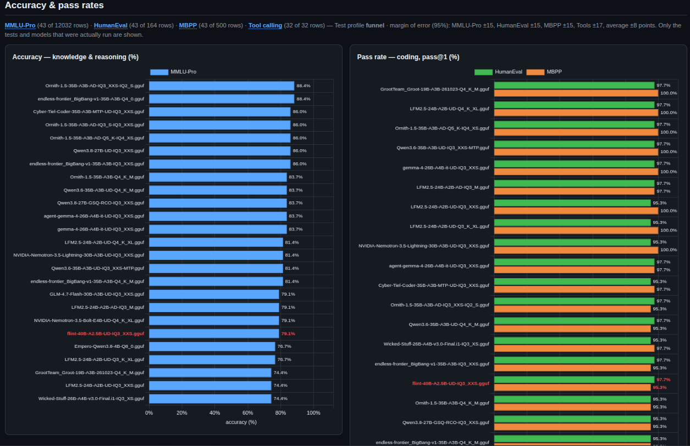
</a>

<a href="./assets/s9.png" target="_blank">
  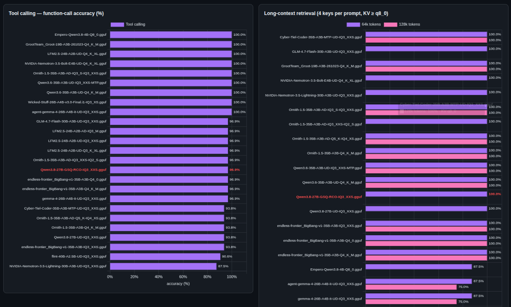
</a>

<a href="./assets/s10.png" target="_blank">
  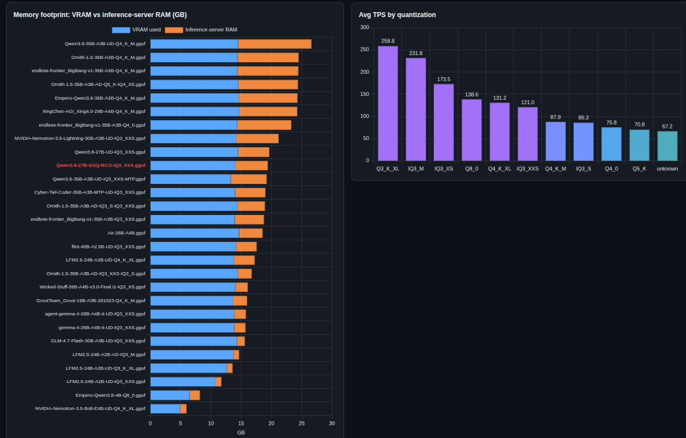
</a>

<a href="./assets/s3.png" target="_blank">
  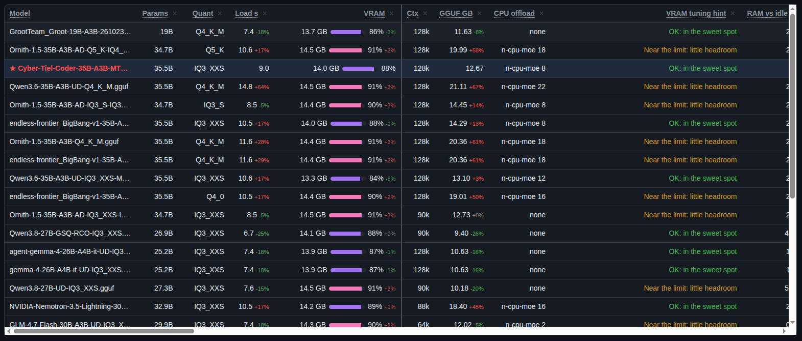
</a>

<a href="./assets/s4.png" target="_blank">
  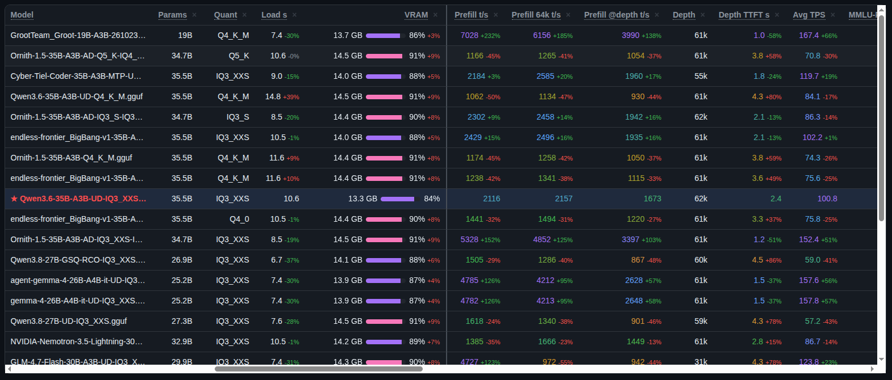
</a>

<a href="./assets/s5.png" target="_blank">
  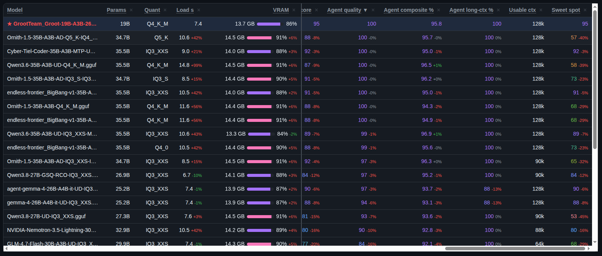
</a>

<a href="./assets/s6.png" target="_blank">
  
</a>

Previous Dashboard v2.2


## 🙏 Credits, datasets and licences

This tool does not include or redistribute any benchmark dataset. Each one is downloaded from Hugging Face at run time (or with `--download-datasets`) into the local `tests/` cache, and is used under the licence and terms set by its authors. All credit for the questions, problems, test cases and reference answers belongs to them. If you publish results produced with these datasets, please cite the original papers below.

The licence of this repository covers its own code only. It does not re-license any dataset, and the dataset licences do not change the licence of this code.

### Evaluation datasets

The suite supports multiple accuracy, reasoning, coding, tool-use, and long-context evaluation datasets.

| Eval | Details | Copy this tool downloads | Original source | Licence | Original authors and paper |
| --- | --- | --- | --- | --- | --- |
| **GPQA Diamond** | 198 questions, 4 choices. Slow and highly expert-level. | [fingertap/GPQA-Diamond](https://huggingface.co/datasets/fingertap/GPQA-Diamond) (community copy of the 198-question Diamond subset) | [idavidrein/gpqa](https://github.com/idavidrein/gpqa) · [Idavidrein/gpqa](https://huggingface.co/datasets/Idavidrein/gpqa) (gated) | [CC BY 4.0](https://creativecommons.org/licenses/by/4.0/), plus the authors' request below | Rein, Hou, Stickland, Petty, Pang, Dirani, Michael, Bowman. *GPQA: A Graduate-Level Google-Proof Q&A Benchmark* (COLM 2024). [arXiv:2311.12022](https://arxiv.org/abs/2311.12022) |
| **MMLU-Pro** | 12,032 questions, up to 10 choices covering broad professional knowledge. | [TIGER-Lab/MMLU-Pro](https://huggingface.co/datasets/TIGER-Lab/MMLU-Pro) | [TIGER-AI-Lab/MMLU-Pro](https://github.com/TIGER-AI-Lab/MMLU-Pro) | MIT. Built from MMLU (Hendrycks et al., [arXiv:2009.03300](https://arxiv.org/abs/2009.03300), MIT), TheoremQA (MIT), SciBench (MIT) and STEM websites | Wang et al. (TIGER-Lab). *MMLU-Pro: A More Robust and Challenging Multi-Task Language Understanding Benchmark* (NeurIPS 2024 Datasets and Benchmarks). [arXiv:2406.01574](https://arxiv.org/abs/2406.01574) |
| **HumanEval** | 164 coding problems, pass@1 metric (runs code securely in the sandbox). | [openai/openai_humaneval](https://huggingface.co/datasets/openai/openai_humaneval) | [openai/human-eval](https://github.com/openai/human-eval) | MIT | Chen et al. (OpenAI). *Evaluating Large Language Models Trained on Code*, 2021. [arXiv:2107.03374](https://arxiv.org/abs/2107.03374) |
| **MBPP** | 500 Python programming problems, pass@1 metric (runs code in the sandbox). | [google-research-datasets/mbpp](https://huggingface.co/datasets/google-research-datasets/mbpp) | [google-research/mbpp](https://github.com/google-research/google-research/tree/master/mbpp) | [CC BY 4.0](https://creativecommons.org/licenses/by/4.0/) | Austin et al. (Google Research). *Program Synthesis with Large Language Models*, 2021. [arXiv:2108.07732](https://arxiv.org/abs/2108.07732) |
| **LiveCodeBench** | 1,055 problems with a date window; a heavy (~4 GB) download and the slowest test suite. | [bzantium/livecodebench](https://huggingface.co/datasets/bzantium/livecodebench) (a copy of `code_generation_lite` in plain JSONL, because the original's loading script no longer works with current `datasets`; default config `release_latest`, 1,055 problems from May 2023 to April 2025) | [LiveCodeBench/LiveCodeBench](https://github.com/LiveCodeBench/LiveCodeBench) (code: MIT) · [livecodebench/code_generation_lite](https://huggingface.co/datasets/livecodebench/code_generation_lite) | The dataset card says "cc" without naming a specific Creative Commons licence, so the exact terms are **unclear**. The problems come from LeetCode, AtCoder and Codeforces, whose own terms apply to the problem statements. The original repository's code is MIT | Jain, Han, Gu, Li, Yan, Zhang, Wang, Solar-Lezama, Sen, Stoica. *LiveCodeBench: Holistic and Contamination Free Evaluation of Large Language Models for Code*, 2024. [arXiv:2403.07974](https://arxiv.org/abs/2403.07974) · [livecodebench.github.io](https://livecodebench.github.io/) |
| **GSM8K** | 1,319 grade-school multi-step mathematical word problems. | [openai/gsm8k](https://huggingface.co/datasets/openai/gsm8k) (`main`) | [openai/grade-school-math](https://github.com/openai/grade-school-math) | MIT | Cobbe et al. (OpenAI). *Training Verifiers to Solve Math Word Problems*, 2021. [arXiv:2110.14168](https://arxiv.org/abs/2110.14168) |
| **MATH-500** | 500 challenging high-school competition math problems. | [HuggingFaceH4/MATH-500](https://huggingface.co/datasets/HuggingFaceH4/MATH-500) | [openai/prm800k](https://github.com/openai/prm800k) (`math_splits`) · [hendrycks/math](https://github.com/hendrycks/math) | MATH is MIT. The Hugging Face card states no licence of its own; the terms of MATH and openai/prm800k apply | The 500 test problems held out by Lightman et al. (OpenAI), *Let's Verify Step by Step*, 2023 ([arXiv:2305.20050](https://arxiv.org/abs/2305.20050)), from the MATH dataset by Hendrycks et al., *Measuring Mathematical Problem Solving With the MATH Dataset* (NeurIPS 2021, [arXiv:2103.03874](https://arxiv.org/abs/2103.03874)) |
| **Tool Calling** | 32 built-in agent use cases testing tool selection and execution (no external download required). | *Built-in suite* | N/A (Internal test case suite) | MIT / Open Source | Local-LLM-Benchmark Built-in Module |
| **Long-Context Retrieval** | Tests retrieval capabilities by hiding specific codes deep inside a very long document. | *Built-in suite* | N/A (Internal test case suite) | MIT / Open Source | Local-LLM-Benchmark Built-in Module |

#### LiveCodeBench: which copy, and which problems

* **Language:** the `bzantium/livecodebench` card's field list says the question text is "translated to Korean". That line appears to be left over from the same author's separate `bzantium/ko-livecodebench`; the Hugging Face viewer shows English problem text for this copy. To be safe, the tool refuses a dataset when more than 1% of the sampled questions contain Korean text.
* **Pinning:** set `EVAL_LIVECODEBENCH_REVISION` (or `EVAL_GPQA_REVISION`, ... for any dataset) to a commit hash of the Hugging Face repository so a later change to a community copy cannot silently change your scores or the tests the sandbox runs. The revision is recorded in `results.json`.
* **Contamination:** LiveCodeBench's own method is to score only problems released after a model's training cutoff. `EVAL_LCB_SINCE=2025-01-01` keeps only problems from that date; older problems may have been seen in training and inflate newer models' scores. Scores with and without the window are not comparable.
* `EVAL_LCB_MAX_TESTS` (default 20) grades on the public tests plus a seeded sample of the private ones, which is a little more lenient than the official harness.

#### GPQA: please honour the authors' request

The GPQA authors ask users **not to reveal examples from the dataset in plain text or images online**, to reduce the risk of the questions leaking into model training data. The official Hugging Face copy is gated behind that agreement. The copy this tool downloads is not gated, but the request still applies. Please accept the terms on [Idavidrein/gpqa](https://huggingface.co/datasets/Idavidrein/gpqa) if you enable `EVAL_GPQA`, and in practice:

* **Do not publish `eval_details_*.jsonl` from a run with GPQA enabled**, nor the result cache (`results/cache/`). Each line holds the model's full reply (which often restates the question) and the reference answer.
* **Do not commit the `tests/` dataset cache or the `results/` folder.** The included `.gitignore` excludes both, so `git add .` will not pick them up.
* Aggregate scores (percentages, charts, the dashboard and `results.json`) contain no questions and are fine to share.

### Methods this tool adapts (no data copied)

| Test | Credit | Licence of the original |
| --- | --- | --- |
| **Tool calling** (`EVAL_TOOLCALL`) | Categories (simple, multiple, parallel, irrelevance) and the AST-style argument matching follow the [Berkeley Function Calling Leaderboard (BFCL)](https://gorilla.cs.berkeley.edu/leaderboard.html) by the Gorilla team at UC Berkeley ([ShishirPatil/gorilla](https://github.com/ShishirPatil/gorilla)). The 32 test cases in `llmbench/evals/toolcall_cases.py` were written for this tool; no BFCL data is used, and the scores are not comparable with the BFCL leaderboard | Apache 2.0 |
| **Long-context retrieval** (`EVAL_LONGCTX`) | The needle-in-a-haystack test by Greg Kamradt ([gkamradt/LLMTest_NeedleInAHaystack](https://github.com/gkamradt/LLMTest_NeedleInAHaystack)), and the multi-key variant from *RULER: What's the Real Context Size of Your Long-Context Language Models?* by Hsieh et al. (NVIDIA, COLM 2024, [arXiv:2404.06654](https://arxiv.org/abs/2404.06654), [NVIDIA/RULER](https://github.com/NVIDIA/RULER)). The haystack, keys and decoys are generated by this tool at run time | See each repository |
| **Margin of error, funnel gates** | The standard 95% binomial interval (worst case, ±98/√n percentage points); the funnel's one-sided bounds use the normal approximation with each dataset's binomial standard error | n/a |
| **Budget forcing** (`EVAL_BUDGET_FORCING`) | Closing the thinking at a token budget and asking for the answer, from *s1: Simple test-time scaling* by Muennighoff, Yang, Shi, Li, Fei-Fei, Hajishirzi, Zettlemoyer, Liang, Candès and Hashimoto, 2025 ([arXiv:2501.19393](https://arxiv.org/abs/2501.19393), [simplescaling/s1](https://github.com/simplescaling/s1)). Only the idea is used; no code or data | Apache 2.0 (s1 repository) |

## 🤖 Acknowledgements
This project was built through a collaborative multi-AI workflow: directed by the author via Gemini to generate detailed prompts, implemented in code by Claude, and thoroughly tested across a suite of local open-source LLMs.

### Software

| Project | Used for | Licence |
| --- | --- | --- |
| [llama-swap](https://github.com/mostlygeek/llama-swap) by mostlygeek | The model-swapping proxy this tool benchmarks through | MIT |
| [llama.cpp](https://github.com/ggml-org/llama.cpp) (ggml-org) | llama-server, its `/props`, `/apply-template`, `/completion` and `timings` fields, and the [GGUF file format](https://github.com/ggml-org/ggml/blob/master/docs/gguf.md) read by `llmbench/gguf.py` (own implementation, no code copied) | MIT |
| [Chart.js](https://www.chartjs.org/) 4.4.1, © 2014-2022 Chart.js Contributors | Dashboard charts. From v2.3.1 the minified build (`dist/chart.umd.js` of the npm package) is bundled in `llmbench/reporting/vendor/` with its licence text and written into every dashboard, so a dashboard opens offline and loads nothing from a CDN | MIT ([licence](llmbench/reporting/vendor/LICENSE-chartjs.md)) |
| [Hugging Face `datasets`](https://github.com/huggingface/datasets) / `huggingface_hub` | Downloading and caching the evaluation datasets | Apache 2.0 |
| [Requests](https://github.com/psf/requests) | HTTP client | Apache 2.0 |
| [aiohttp](https://github.com/aio-libs/aiohttp) | Concurrent evaluation requests | Apache 2.0 |
| [python-dotenv](https://github.com/theskumar/python-dotenv) | `.env` loading | BSD 3-Clause |
| [nvidia-ml-py](https://pypi.org/project/nvidia-ml-py/) (NVIDIA) | NVML GPU telemetry (`pynvml`) | BSD 3-Clause |

Dependencies are installed by you from PyPI and are not redistributed here, with one exception: Chart.js is bundled (see its row). Each project's licence applies to it.

If you are an author of one of these works and would like the credit worded differently, or a dataset removed, please open an issue.
